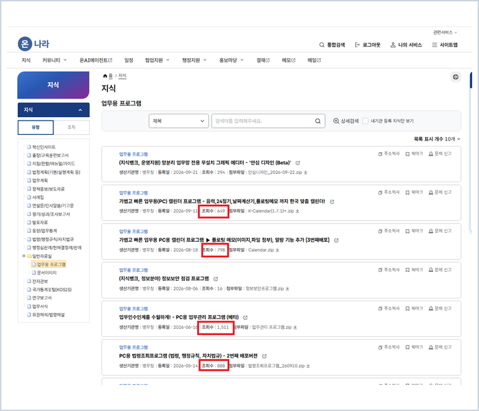
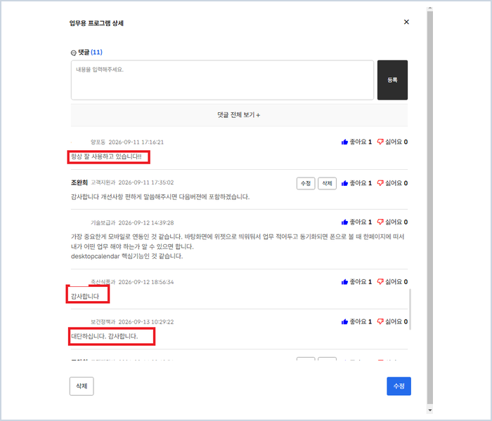
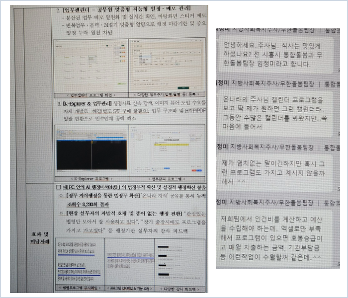
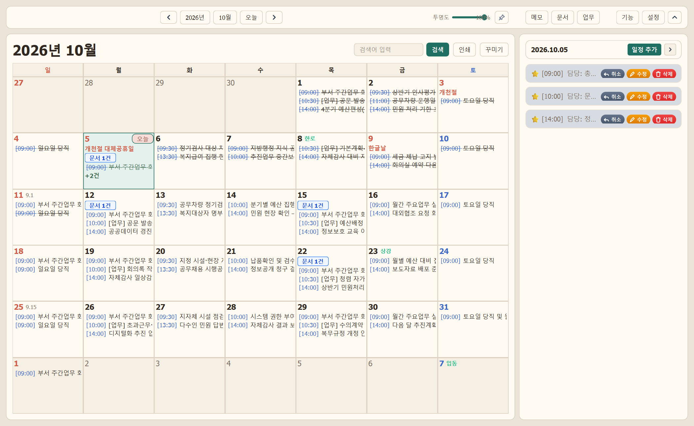
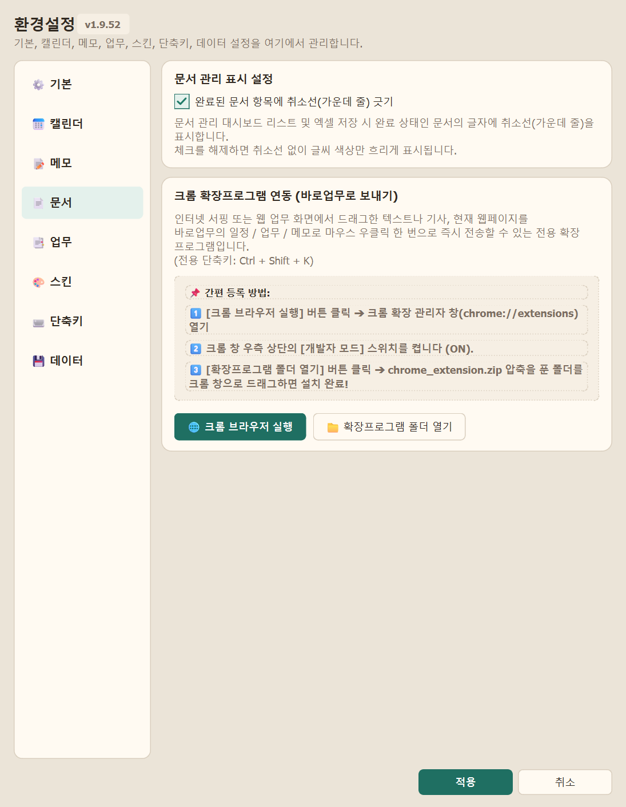
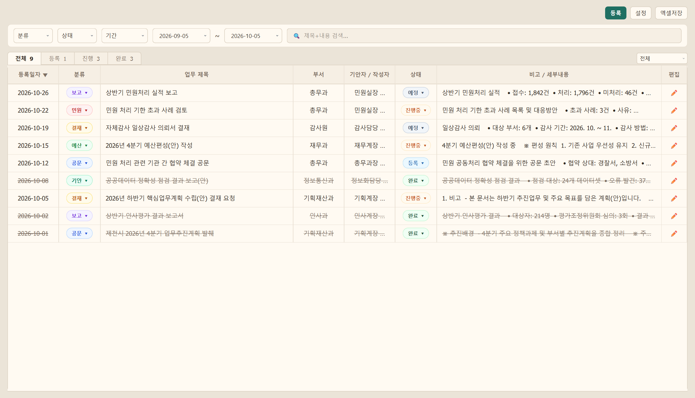
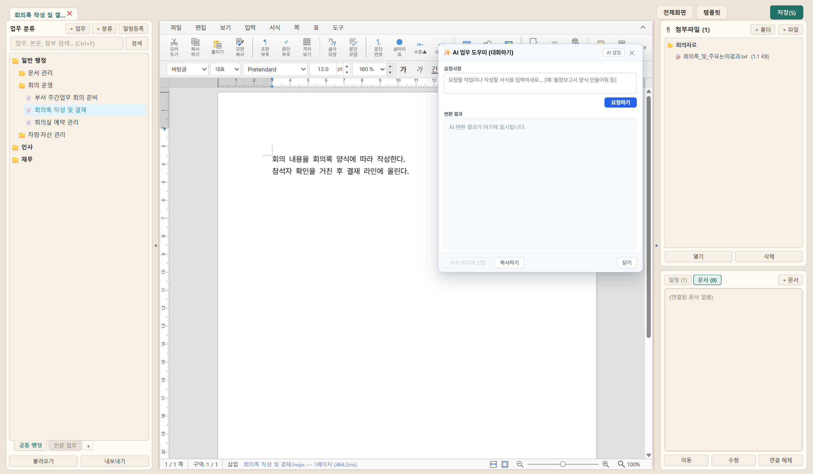
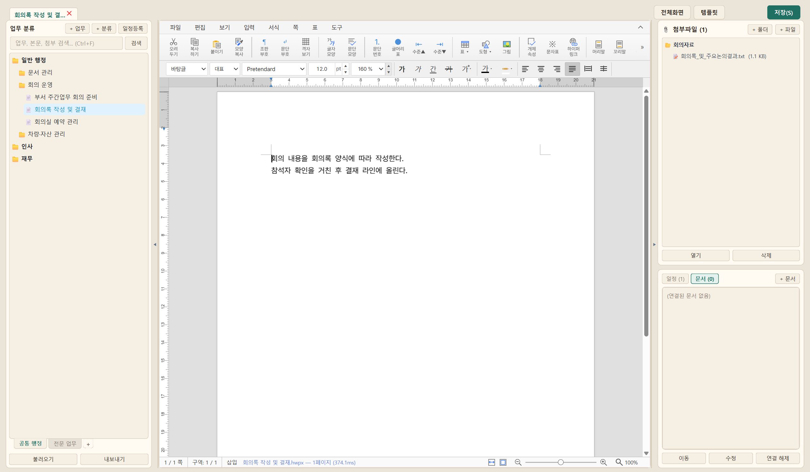

# 바로업무 (TaskCalendar) v2.1.5 (2026-10-23)

> **[2026 공공 AI 대전환 챌린지 세션 2] 지정과제 ① 「업무바통(인수인계)」 공식 제출 산출물**  
> **저장소 토픽(Topics):** `2026 공공 AI 대전환 챌린지 세션2`  
> **공공 GitLab 저장소:** [https://gitlab.aigov.go.kr/westock/TaskCalendar](https://gitlab.aigov.go.kr/westock/TaskCalendar)  
> **작품명:** 세션2 업무바통 바로업무 - 온나라 연계 AI 인수인계 솔루션  
> **개발 표준:** 행정안전부 《행정업무운영 편람》 공문서 개조식 어법 준수, 전자정부 SW 개발보안 가이드 100% 준수 (Semgrep·Gitleaks·Trivy 무결점 통과)

---

## 🏛️ 심사위원 전용 3분 퀵 스타트 가이드 (Quick Start)

본 산출물은 별도의 파이썬 또는 데이터베이스 설치 없이 **무설치 포터블 실행 파일(`바로업무.exe`)** 하나로 즉시 평가 및 시연이 가능하도록 구성되어 있습니다.

### 1. 실행 파일 위치
* **GitHub 저장소에는 소스코드만 있습니다.** 실행 파일(`바로업무.exe`, 약 200MB)은 GitHub 파일 크기 제한(100MB)으로 포함하지 않습니다.
* 실행 파일은 공공 GitLab 저장소의 [`공모전_제출자료_261020/02_실행프로그램(무설치)/`](https://gitlab.aigov.go.kr/westock/TaskCalendar) 폴더에서 받거나, 아래 [실행 방법](#실행-방법)대로 직접 빌드합니다.
* `바로업무.exe`를 더블클릭하면 메인 캘린더가 열립니다. 단일 실행 파일이 임시 폴더에 압축을 풀기 때문에 최초 실행은 수십 초가 걸릴 수 있습니다.
* 공모전 공식 서식 및 안내문서:
  * 📄 **참가신청서:** [`공모전_제출자료_261020/00_참가신청서/참가신청서_261022.hwpx`](공모전_제출자료_261020/00_참가신청서/참가신청서_261022.hwpx)
  * 📘 **구동안내서:** [`공모전_제출자료_261020/01_구동안내서/구동안내서_261020.hwpx`](공모전_제출자료_261020/01_구동안내서/구동안내서_261020.hwpx)

---

## 🌟 구동안내서 기반 4대 핵심 기능 상세 명세

본 솔루션은 전임자 퇴직·전보 시 발생하는 구조적 업무 공백과 자료 유실을 원천 차단하고, 복잡한 인수인계를 당일 1시간 내에 완료하도록 돕는 공직 특화 AI 인수인계 플랫폼입니다.

### 1. 🗂️ 비파괴적 폴더 기반 인수인계 자동 구조화 (업무 연속성 보장)
* **전임자 폴더 원클릭 바통터치:** 전임자의 복잡한 윈도우 폴더를 마우스 드래그 한 번으로 `대분류 > 중분류 > 단위업무` 계층 트리로 1초 만에 자동 구조화합니다.
* **디스크-DB 양방향 실시간 동기화:** 업무 분류가 실제 파일 디렉터리(`work/<그룹>/<분류>/<업무명>.hwpx`)로 관리되어, 윈도우 탐색기에서 파일명을 바꾸거나 파일을 추가해도 프로그램과 실시간 동기화됩니다.
* **포터블 인수인계 팩 내보내기/불러오기:** 업무 본문(HWPX), 첨부파일, 연계 일정, 관련 문서 링크, 실무 메모가 압축 패키지 하나로 온전히 보존되어 후임자에게 완벽하게 전달됩니다.

### 2. 🌐 온나라 전자결재 1초 스크랩 & 브라우저 실무 메모 연동
* **웹 결재문서 우클릭 원클릭 스크랩:** 크롬 확장프로그램(단축키 `Ctrl + Shift + K`)을 통해 온나라 전자결재창에서 마우스 우클릭 한 번으로 기안문 제목, 본문 요약, 결재선 정보를 바로업무의 해당 업무 카드로 즉시 전송합니다.
* **해당 페이지 웹 메모(URL 핀포인트):** 법령 정보, 타 부처 고시, 온나라 결재 화면 위에 포스트잇 형태의 메모를 부착하여 해당 페이지 재방문 시 실무 지침과 유의사항이 자동으로 떠오릅니다.
* **윈도우 탐색기 우클릭 등록:** 탐색기에서 문서를 선택하고 우클릭하면 바로업무의 진행 중인 업무 카드로 즉시 첨부 보관됩니다.

### 3. 🤖 생성형 AI 기반 법령·행정절차 자동 대조 및 표준 공문서 생성
* **국가법령정보 실시간 연동 (DRF API):** 업무 본문에서 인용된 법령(예: 공유재산 및 물품 관리법 제65조)을 자동으로 인식하고, 최신 법령 조문과 업무 내용을 실시간 대조합니다.
* **필수 행정 절차 및 누락 서류 AI 사전 검증:** 불용품 매각, 예산 편성, 일상감사 등 행정 절차 표준을 대조하여 누락된 필수 첨부서류나 잘못된 위임전결 결재선을 사전에 경고하고 수정안을 자동 제시합니다.
* **행정업무운영 편람 준수 표준 인수인계서(HWPX) 자동 생성:** 실무 메모와 수집된 결재문서들을 취합하여 표준 서식(표, 칸, 개조식 어법 준수)을 갖춘 정식 HWPX 인수인계서 초안을 1초 만에 자동 생성합니다.

### 4. 🏛️ 공무원 실무 밀착 올인원 행정 유틸리티
* **대한민국 전 기간 공휴일/대체공휴일 동적 계산 엔진:** 역대 대통령령 및 임시공휴일을 포함한 완전 자동 계산(음력 및 24절기 표기 지원).
* **부서 필드 & 공공기관 맞춤형 엑셀 내보내기:** 업무 추진 실적 및 계획을 공공 감사·보고 규격 엑셀로 원클릭 출력.
* **스마트 플로팅 메모 그룹 (위젯):** 다른 업무 중에도 바탕화면에 항상 떠 있는 독립 메모 그룹, 화면 캡처 및 비상연락망 박제 기능 제공.
* **외부 통신 없는 100% 로컬 무손실 암호화:** Windows DPAPI 기반 로컬 DB 암호화 적용으로 보안 감사와 행정망 보안 지침을 완벽 충족합니다.

---

## 🚀 3단계 핵심 기능 평가 흐름 (구동안내서 시연 순서와 동일)


1. **📁 [1단계: 업무 인수인계 & AI 법령 검토]**
   - 상단 메뉴의 **[업무]** 버튼 클릭 후 `공모전_제출자료_261020/04_모의데이터_인수인계샘플/` 폴더를 화면 좌측 업무 트리로 드래그합니다.
   - [모두 덮어쓰기] → [인수인계 시작] 클릭 시 서무복무·예산회계·현안사업 3개 그룹과 30개 단위업무가 1초 만에 자동 복원됩니다.
   - `1/물품자산/불용품처분계획.hwpx` 클릭 후 상단 **[참조 법령: 공유재산법 제65조]** 배너 클릭 ➔ **[AI 법령 대조 분석]** 실행 시 누락 절차를 자동 감지하고 문서에 즉시 반영합니다.
2. **📅 [2단계: 일정·메모 열린 업무창 입체 연동]**
   - 좌측 상단 [일정등록] 클릭 시 캘린더 11월 13일 날짜에 『물품심사위원회 개최』 일정이 즉시 등록됩니다.
   - 우측 상단 [플로팅 메모] 클릭으로 바탕화면 분리 메모 위젯을 띄우고 실무 비상연락망을 박제합니다.
3. **🌐 [3단계: 문서·연동 전자결재 & 탐색기 연동]**
   - `공모전_제출자료_261020/05_온나라_모의전자결재사이트/온나라_모의전자결재사이트.html`을 브라우저로 엽니다.
   - 결재문서 우클릭 ➔ **[바로업무로 보내기]**를 클릭하면 열려 있는 불용품처분계획 업무 카드로 결재선과 본문이 실시간 누적 스크랩됩니다.
   - 상단 **[업무 부가기능] ➔ [메모로 문서 생성]** 클릭 시 행정 표준 서식(HWPX) 인수인계서가 즉시 생성됩니다.

---

## 🏆 온나라 지식 배포 8,230회 돌파 및 실전 검증 실적

본 솔루션은 개발 단계의 단순 시제품이 아니라, **정부 지식행정포털(온나라 지식)을 통해 실제 행정 현장에 선제 배포되어 수천 명의 공직자에게 검증받은 완성형 시스템**입니다.

| 증빙 1. 온나라 지식 배포 현황 | 증빙 2. 전국 실무자 감사 댓글 | 증빙 3. 타 부처 감사 메일·메신저 |
| :---: | :---: | :---: |
|  |  |  |
| **누적 조회수 8,230회 돌파**<br>기관 우수지식 공식 선정 | **전국 공직자 호평 찬사**<br>"인수인계 악몽을 없앤 혁신 도구" | **타 지자체(시흥시 등) 소통**<br>실무 피드백 수렴 및 즉각 환류 |

---

## 🤖 개방형 AI 아키텍처 및 보안 체계 (모델 비종속성)

공모전 공통 개발 규칙을 엄격히 준수하여 특정 상용 모델에 종속되지 않는 유연한 개방형 설계를 채택하였습니다.

* **다양한 모델 교체 지원:** Google Gemini 1.5 Pro / Flash, OpenAI GPT, HyperCLOVA X, Llama 3, Gemma, EXAONE 등 표준 REST API를 지원하는 모든 파운데이션 모델과 즉시 연동 가능합니다.
* **폐쇄망 온프레미스 LLM & 오프라인 룰 엔진 탑재:** 인터넷이 차단된 행정 폐쇄망 환경에서도 Ollama 기반 로컬 경량 LLM 및 내장 룰베이스 엔진을 통해 100% 정상 구동됩니다.
* **정부 SW 개발보안 기준 준수:** SSL 인증서 검증 무결성 확보, API 키 및 로컬 DB의 Windows DPAPI 암호화 저장, 외부 비인가 통신 차단.

---

## 📂 공모전 제출 산출물 구조

```text
c:/Pro1/TaskCalendar/
├── 공모전_제출자료_261020/
│   ├── 00_참가신청서/
│   │   ├── 참가신청서_261022.hwpx     # 공모전 공식 2페이지 무결성 참가신청서
│   │   └── 참가신청서_261022.md       # 신청서 마크다운 명세
│   ├── 01_구동안내서/
│   │   ├── 구동안내서_261020.hwpx     # 심사위원용 공식 구동안내서 (HWPX)
│   │   ├── evidence_photo1~3.png     # 온나라 지식 배포, 댓글, 메일 실증 증빙
│   │   └── 구동안내서_261020.md       # 구동안내서 전문
│   ├── 02_실행프로그램(무설치)/
│   │   ├── 바로업무.exe               # 단일 실행 파일 (GitHub 미포함 — GitLab 저장소 참조)
│   │   └── data/                      # 기본 공무 템플릿 및 설정 DB
│   ├── 03_크롬_확장프로그램/          # 온나라/행정망 텍스트·결재 원클릭 스크랩 확장팩
│   ├── 04_모의데이터_인수인계샘플/    # 실제 공무원 1년치 예시 인수인계 문서팩 (서무·예산·현안)
│   └── 05_온나라_모의전자결재사이트/  # 온나라 전자결재 연동 시연용 웹페이지
├── taskcalendar/                     # 바로업무 파이썬 소스코드 패키지 (PyQt6 기반)
├── README.md                         # 본 안내 문서
└── run_app.py                        # 파이썬 개발 환경 실행 엔트리포인트
```

---

# 바로업무 (TaskCalendar) 프로그램 일반 안내

---

# 바로업무 (TaskCalendar) 프로그램 일반 안내

**바로업무**는 Windows 데스크톱 환경에서 공무 및 업무 효율을 극대화하는 스마트 개인 일정·메모 관리 솔루션입니다.  
새롭게 추가된 **내장 글꼴(Pretendard) 및 150% 고해상도 글꼴 품질 개선**, **환경설정 UI 가독성 향상**, **캘린더 업무내역 표시 및 처리상태 필터링**, **대한민국 전체 공휴일/대체공휴일 동적 계산 엔진**, **부서 필드 & 커스텀 엑셀 내보내기**, **전용 업무 관리자(Task Manager, 상태별 탭·페이징·인라인 수정·100% 반응형 너비)**, **Chrome 확장 프로그램 웹 연동(사이트별 맞춤 추출 규칙·윈도우 프로토콜 연동)**, **스마트 날짜 계산기(D-Day, 기념일, 법정공휴일 제외 영업일/근무일 산정, 나이/근속기간)**, **음력 및 24절기 자동 표기**, **음력 매년 반복 일정(생일/제사)**, **다채로운 일정 스티커/아이콘**, **우측 기준 스마트 확장 및 화면 밖 넘침 방지**, 스마트 플로팅 메모(바탕화면 자동 복원), 첨부파일(폴더 열기 지원), 사전 알람, 전역 단축키, 무손실 로컬 데이터 암호화 저장을 지원합니다.

---

## 📸 주요 화면 미리보기

바로업무의 4가지 핵심 기능을 화면으로 확인할 수 있습니다.

### 01. 일정 관리 — 월간 캘린더

한 달 전체를 한눈에 보고, 음력·24절기·공휴일을 자동으로 표시합니다. 하루에 여러 일정이
쌓여도 시간이 함께 보이며, 클릭하면 오른쪽에서 그날의 일정과 메모를 함께 확인할 수 있습니다.



### 02. 메모 관리 — 바탕화면 플로팅 메모와 그룹

메모를 달력 안이 아닌 **바탕화면 위에 떠 있는 창**으로 관리합니다. 다른 일을 하다 잠시
옮겨두고 쓰는 업무 메모에 가깝습니다. 그룹별로 묶을 수 있고, 그룹 안에서 메모를 완료
처리하거나 모두 닫는 버튼, 창을 늘려두는 고정(pin) 기능도 있습니다. 메모 그룹을 여러 개
만들어 업무용·개인용으로 나누어 둘 수 있습니다.


### 03. 문서 관리 — 크롬 브라우저에서 바로 등록·연계

문서를 직접 타이핑하는 것만큼, **웹에서 바로 가져올 수 있습니다.** 크롬 확장 프로그램
「바로업무로 보내기」를 설치하면 인터넷 서핑 중이거나 웹 업무 화면에서 텍스트를 드래그한 뒤
**우클릭 한 번**으로 그 내용을 바로업무의 일정 · 업무 · 메모로 즉시 전송할 수 있습니다
(전용 단축키 `Ctrl + Shift + K`).

확장 프로그램 설치는 환경설정 → 📄 문서 탭의 「크롬 확장프로그램 연동」 카드에서 진행합니다.
이 화면이 설치 안내 역할을 함께 하며, `🌐 크롬 브라우저 실행` 버튼으로 크롬 확장 관리자를
열어 주고 `📁 확장프로그램 폴더 열기`로 압축을 푼 폴더를 드래그하면 끝납니다.



문서 목록에서는 분류·부서·상태별로 정리하고 검색·필터링할 수 있으며, 이 문서를 그대로
업무 항목의 관련 문서로 연결할 수도 있습니다.



### 04. 업무 관리 — 단위업무와 AI 도우미

업무를 분류 트리로 정리하고, 각 업무의 본문을 한글(HWPX) 에디터로 작성합니다.
이 에디터는 **이미지 첨부**와 **HWP 문서 드래그&드롭**을 지원하므로, 공문 서식과 표를
그대로 옮겨 붙여 정식 문서를 빠르게 만들 수 있습니다. 우측에서 첨부파일과 관련 일정·문서를
한 화면에 모아 한 업무에 필요한 모든 자료를 볼 수 있습니다.

또한 본문에서 **AI 업무 도우미**를 함께 쓸 수 있습니다. `대화하기`로 공문서·보고서 서식
문장을 작성하고, `업무 분석기`로 본문에서 관련 법령과 필수 행정 절차를 자동으로 찾아 줍니다.



업무를 다른 업무와 연결하면 업무 흐름 전체를 편람처럼 활용할 수 있습니다.



📖 **[👉 사내 임직원 업무 활용 가이드 상세 보기 (docs/TaskCalendar_업무활용가이드.md)](docs/TaskCalendar_업무활용가이드.md)**

---

## 💾 다운로드 (실행 프로그램)

* 🚀 **[바로업무 v1.9.98 다운로드 (최신 버전)](https://github.com/wookoon2024/TaskCalendar/releases/download/v1.9.98/baro_1.9.98_20261010.zip)**

  **압축 풀면 아래 4종이 들어 있습니다:**
  | 항목 | 설명 |
  |---|---|
  | `바로업무.exe` | 실행 파일 (별도 설치 불필요) |
  | `업무 템플릿/` | 공무원 표준 서식 21종 (기안·보고·결재·민원·감사 등) |
  | `이미지 템플릿/` | 일러스트·장식·이미지·카툰 라이브러리 (543개) |
  | `chrome_extension.zip` | 크롬 확장 프로그램 |
  | `사용법.txt` | 설치·사용 안내 |

  `db/`·`data/` 폴더는 exe를 처음 실행하면 자동으로 만들어집니다.

  **크롬 확장 설치**: 환경설정 → 📄 문서 → [🌐 크롬 브라우저 실행] → 개발자 모드 켜기 → [📁 확장프로그램 폴더 열기]로 zip을 풀어 드래그

---

## ✨ 주요 기능

* **🗂️ 업무 파일·첨부를 폴더(work) 기준으로 관리 [v1.9.98 최신]**:
  * 업무 분류가 **실제 폴더**가 됩니다: `work/<그룹번호>/<분류계층경로>/<제목>.hwpx` (하단 탭=그룹, 분류는 상위 폴더까지 중첩)
  * **본문·첨부가 실제 파일**이라 인수자가 탐색기에서 그대로 열 수 있습니다 (`.hwp/.hwpx`는 내장 에디터, 그 외는 윈도우 기본 프로그램)
  * 첨부는 `work/attach/<그룹>/<분류>/<업무명>/`에 모이고, **탐색기에서 파일·폴더 이름을 바꿔도 바로 반영**
  * 업무 이름 변경·분류 이동·분류 이름 변경·삭제 시 **디스크 폴더도 함께 이동**
  * **동기화 창**(2단계·그룹 탭·분류 중첩 트리): 파일 없음/DB 없음 항목을 정리하고, 이름만 바뀐 문서는 내용 해시로 자동 인식
  * **내보내기**(그룹 폴더 복원 + `work.json` 동봉) / **불러오기**(`work.json` 또는 폴더명 기준)
* **🖼️ 한글 에디터 본문 이미지 드래그&드롭 [v1.9.54]**:
  * 탐색기에서 이미지 파일(`.png`, `.jpg`, `.jpeg`, `.gif`, `.bmp`, `.webp`, `.svg`)을 한글 본문으로 끌어다 놓으면 커서 위치에 즉시 삽입
  * 이미지 외 비이미지 파일 혼합 드롭 시 안전하게 이미지만 자동 필터링 삽입
* **🎨 다크/블랙 스킨 테마 시인성 & 대화상자 스타일 고도화 [v1.9.54]**:
  * 미저장 확인 등 알림 대화상자(`QMessageBox`)에 다크 모드 스타일이 완벽 연동되어 어두운 화면에서도 선명한 가독성 보장
  * 좌측 업무 분류 트리 및 우측 첨부파일 트리의 호버·선택 배경과 텍스트 대비 최적화
* **🤖 AI 업무 도우미 & 법령 찾기 [v1.9.54]**:
  * **본문 우클릭 AI 도우미**: `[대화하기]`로 공문서·보고서 서식 작성, `[업무 분석기]`로 본문에서 관련 법령과 필수 행정 절차 자동 분석
  * **국가법령정보센터 법령 찾기**: `[법령 찾기]`로 현행·연혁 법령을 검색해 공식 페이지(`law.go.kr`)로 바로 연결
    - 기관 전용 Open API 키 적용으로 개칭이 바뀐 구법령(예: 「개인정보 보호에 관한 법률」)도 검색됩니다
    - `현행 법령만 보기` 필터로 구법령을 한 번에 숨길 수 있습니다
  * **AI 설정 연결 테스트**: 입력 중인 엔드포인트·키·모델로 실제 호출해 성공·실패를 즉시 표시
* **📖 기능 안내 5분류 페이지 [v1.9.54]**:
  * `일정 관리`·`메모 관리`·`문서 관리`·`업무 관리`·`환경설정` 5개 분류로 정리
  * 좌측 목록 또는 `[← 이전] [다음 →]` 버튼으로 분류별 상세 안내를 차례대로 확인
  * 각 분류마다 실제 사용법과 **다른 기능과의 연계 방법** 설명 포함

* **🪟 메모/그룹 화면 밖 넘침 완벽 차단 [v1.9.3]**:
  * **상하좌우 모든 방향 클램핑**: 화면 우측에 붙인 메모/그룹을 펼칠 때 좌측뿐 아니라 하단으로도 새어나가던 문제 수정
  * **작업 영역 기준 통합 보정**: X·Y·폭·높이를 화면 작업 영역(`availableGeometry`) 안으로 한 번에 보정
  * **과도한 크기 자동 축소**: 메모 자체가 화면보다 크면 위치뿐 아니라 크기도 화면에 맞춰 잘림 없이 표시
  * **메모/그룹 동시 적용**: 일반 메모와 그룹 메모 양쪽 펼침/접힘 경로에 동일한 로직 적용
  * **다중 모니터 대응**: 보조 화면(음수 좌표) 경계에서도 동일하게 화면 안에 유지
* **🔤 내장 글꼴(Pretendard) & 150% 고해상도 글꼴 품질 개선 [v1.9.1]**:
  * **Pretendard TTF 글꼴 탑재**: Windows DirectWrite에 최적화된 TrueType 정식 글꼴 적용
  * **고해상도(150% 배율) 렌더링 최적화**: 힌팅 왜곡 방지(`PreferNoHinting`) 및 앤티앨리어싱 개선으로 계단현상 없는 부드러운 벡터 곡선 출력
  * **환경설정 UI 가독성 향상**: 좌측 메뉴 글자 크기를 14px DemiBold로 확대, 콤보박스 텍스트 정렬 및 실시간 미리보기 카드 박스 적용
  * **앱 전체 즉시 반영**: 설정 변경 시 열려 있는 창을 포함해 앱 전체 글꼴/크기가 재시작 없이 즉시 적용
  * **OFL-1.1 라이선스 고지**: 오픈소스 고지에 Pretendard(OFL-1.1) 항목 및 라이선스 전문 탭 추가
* **🪟 창 겹침 순서(Z-order) 개선 [v1.9.0]**:
  * **캘린더 클릭 시 최상위 전환**: 캘린더 창 클릭 시 메모/그룹 창 위로 자연스럽게 올라오도록 개선
  * **캘린더 숨김 시 메모 유지**: 캘린더를 숨겨도 메모/그룹 창이 다른 창에 가려지거나 깜박이지 않도록 임시 최상위 처리
  * **재표시 시 위치 보정**: 캘린더 재표시 직후 사용자가 클릭한 결과를 되돌리지 않도록 타이밍 보정

* **📌 캘린더 업무내역 표시/필터링 및 한국 공휴일 엔진 [v1.8.9]**:
  * **캘린더 업무내역 표시 & 상태 필터링**: 환경설정 캘린더 탭에서 업무내역 표시 여부 및 표시할 처리상태(등록, 진행중 등)를 다중 선택하여 필터링
  * **업무 처리상태 자동 연동**: 업무 관리창에서 특정 상태 삭제 시 환경설정 옵션에서도 자동 삭제 동기화
  * **대한민국 전체 공휴일/대체공휴일 동적 엔진**: 추석, 설날, 대체공휴일, 선거일 등 누락 없는 정밀 자동 계산 및 표기
  * **부서 필드 & 커스텀 엑셀 내보내기**: 업무 기안자 부서 필드 지원 및 원하는 기간/조건의 엑셀 추출 기능
  * **접힘 메모 화면 위치 복원 최적화**: 메모 접힘 상태에서 프로그램 재시작 시 앵커 좌표 밀림 방지

* **📋 전용 업무 관리자(Task Manager) 및 브라우저 연동 [v1.7.0]**:
  * **전용 업무 관리창**: 상단바 [업무] 버튼으로 진입하여 등록된 전체 업무를 효율적으로 관리
  * **상태별 탭 & 페이징 모드**: 전체 / 등록 / 진행 / 완료 탭 및 우측 페이징 셀렉터(전체, 10/20/50개씩, 일별, 주간별, 월별) 지원
  * **직관적인 편집 & 조작**: 셀 더블클릭 즉시 수정(인라인 에디팅), 헤더 컬럼 좌우 크기 조절, 우클릭 메뉴(상세 수정/출처 웹페이지 열기/삭제)
  * **Chrome 확장 프로그램 웹 연동 (`chrome_extension/`)**: 웹 브라우징 중 텍스트 드래그 우클릭으로 바로업무 일정/업무/메모 등록 팝업 호출
  * **`taskcalendar://` 프로토콜 & 단일 인스턴스 IPC**: 브라우저에서 등록 요청 시 백그라운드/최소화된 캘린더를 즉시 최상위로 활성화하고 등록창 호출

* **📅 스마트 다기능 날짜 계산기 & 일정 등록 연계 [v1.6.0]**:
  * **상단바 전용 버튼**: 상단바 알람 버튼 우측에 `[날짜계산기]` 원클릭 진입 툴바 제공
  * **탭 1. 일수 / D-Day 계산**:
    * 기준일과 대상일 간격 계산 (시작일 당일 1일째 포함 옵션 제공)
    * D-Day 배지(`D-Day`, `D-10`, `D+15` 등), 총 일수, 주/일 환산(`N주 M일`), 연/월/일 분할 상세 표기
    * `[+ 대상일로 일정 등록]` 원클릭 시 캘린더 일정 등록창으로 자동 연계
  * **탭 2. 기념일 계산**:
    * 100일, 200일, 300일, 500일, 1000일 및 1~10주년 자동 산정 테이블
    * 계산된 각 기념일의 정확한 요일 및 **음력 날짜** 병기
    * N일/주/개월/년 전·후 커스텀 날짜 계산기 내장 및 항목별 `[+ 등록]` 버튼 제공
  * **탭 3. 영업일(근무일) 계산 (법정 공휴일 및 주말 자동 제외)**:
    * 대한민국 법정공휴일/대체공휴일 및 주말(토/일)을 자동 판별·제외하는 정밀 엔진
    * `기간 내 영업일수 산출`: 기간 내 주말 일수, 제외된 공휴일 상세 목록, 순수 영업일수 계산
    * `N영업일 후 마감일 계산`: 기준일로부터 N영업일 후 최종 마감 일자 및 제외된 휴일 정보 산출
    * `[+ 마감/영업일정 등록]` 원클릭 캘린더 등록 연계
  * **탭 4. 만 나이 / 근속기간 계산**:
    * 생년월일 기준 **만 나이(생일 경과 여부 반영)**, **연 나이**, **띠 및 육십갑자(간지)** 자동 산정
    * 다가오는 다음 생일까지 D-Day 계산 및 `[+ 생일 일정 등록]`
    * 입사일 기준 현재(또는 퇴사일)까지의 총 근속기간(N년 M개월 D일) 및 총 재직일수 산정, `[+ 기념일 일정 등록]`
* **🏷️ 공식 브랜드 명칭 "K캘린더" 반영 [v1.6.0]**:
  * 메인 윈도우 제목, 트레이 아이콘 툴팁, 기능 안내 다이얼로그 전반에 "K캘린더" 명칭 적용
* **📐 우측 기준 스마트 확장 & 화면 밖 넘침 방지 및 상단바 제어 [v1.5.3]**:
  * **우측 화면 밖 넘침 방지 & 스마트 확장**: 환경설정의 `[메모/그룹 펼칠 때 우측 기준으로 확장]` 옵션 활성화 시, 화면 중앙에서는 왼쪽 기준(우측 확장)을 유지하고 화면 우측 끝에 밀착되어 있을 때만 우측 모서리를 고정한 채 왼쪽으로 안전하게 확장
  * **접힘 시 우측 밀착 위치 완벽 복귀**: 우측 끝에 붙은 상태에서 메모/그룹을 펼쳤다가 다시 접을 때, 좌측 기준으로 닫혀 우측 밀착이 풀리던 문제를 완벽 해결하고 우측 가장자리에 밀착된 원래 위치로 정확히 복귀
  * **환경설정 즉시 전역 연동**: 설정 변경 시 앱 재시작 없이 현재 열려 있는 모든 메모 및 그룹 창에 우측 기준 모드 즉각 실시간 반영
  * **상단바 윈도우 제어(투명도/핀) 표시 옵션**: 환경설정 일반 탭에서 상단바의 투명도 조절 슬라이더 및 항상 위 고정(핀) 버튼 표시 여부 On/Off 토글 지원
* **📐 메모 접기/펼치기 크기 독립 유지 & 테두리 더블클릭 확장 [v1.5.2]**:
  * **접힘/펼침 가로 크기 각각 독립 저장**: 내용이 길 때 펼쳐진 상태의 크기와 접힌 상태에서 콤팩트하게 줄인 가로 크기를 각각 독립 기억/복원
  * **우측 테두리 더블클릭 스마트 확장/복귀**: 접힌 상태에서 우측 테두리(↔ 커서)를 더블클릭하면 열렸을 때의 가로 너비로 즉시 자동 확장 (재클릭 시 콤팩트 크기 복귀)
  * **메모 좌측 사이드 크기 조절**: 우측뿐만 아니라 좌측 테두리 드래그로도 자유롭게 너비 조절 지원
  * **새 그룹 메모 한 줄 목록 기본화**: 새 그룹 생성 시 한 줄 목록(`list`) 뷰 기본 적용
  * **팝업 창 WindowModal 전환**: 일정 등록창, 환경설정창 등이 열려 있어도 바탕화면 메모를 자유롭게 이동/조작 가능
  * **상단바/사이드바 토글 버튼 순서 최적화**: `[상단바 표시]` `[사이드바 표시]` 순서 배치
* **📁 스마트 플로팅 메모 그룹 관리 (프로젝트·업무별 폴더화)**:
  * **바탕화면 폴더형 그룹 창**: 여러 개의 메모를 프로젝트나 업무 주제별로 하나의 폴더형 창에 묶어 바탕화면에 깔끔하게 띄워두고 체계적으로 관리
  * **보기 모드 전환 (한 줄 목록형 ↔ 카드형)**: 상단 뷰 아이콘 클릭 시 심플한 한 줄 목록(`list`) 뷰와 카드형(`card`) 뷰를 원클릭으로 손쉽게 전환
  * **그룹 내 메모 일괄 열기 / 닫기**: 그룹 내 모든 메모를 바탕화면에 한 번에 펼치거나 닫을 수 있어 멀티태스킹 작업 전환 최적화
  * **메모 ↔ 그룹 상호 자석 스냅**: 그룹 창과 일반 메모 창 간의 양방향 1px 정밀 자석 스냅(밀착) 효과로 깔끔하고 정돈된 화면 배치
  * **상단바 여백 더블클릭 콤팩트 접기/펼치기**: 상단바 여백, 아이콘 더블클릭 시 36px 슬림 타이틀바로 신속히 접혀 작업 공간 극대화
  * **제목 더블클릭 전용 인라인 편집**: 일반 메모와 동일하게 제목 텍스트를 더블클릭할 때만 편집 모드로 전환되어 평상시 오입력 방지
  * **우측 기준 스마트 확장 및 테두리 더블클릭 확장**: 화면 우측 끝에 밀착 시 창 넘침 없이 안전하게 확장되고 원래 위치로 완벽 복귀
* **🛡️ Windows 계정 변경 무손실 백업/복원 및 엑셀 설정 백업 [v1.5.1 신규]**:
  * **윈도우 계정 독립형 복구**: ZIP 백업에 기기 독립형 SQLite 데이터(`taskcalendar.db`)를 포함하여 다른 윈도우 계정/새 PC에서도 DPAPI 복호화 오류 없이 100% 원클릭 복원
  * **자동 백업 안전망**: 자동 백업 시 `.sqlite.bak` 스냅샷 동시 생성으로 윈도우 계정이 변경되어도 앱 시작 시 무손실 자동 복구
  * **엑셀(XLSX) 환경설정 백업/복원**: 엑셀 내보내기 시 `settings` 시트를 생성하여 테마, 단축키, 메모 옵션 등 모든 설정을 함께 백업하고 복원 지원
  * **복원 즉시 전역 설정 반영**: 백업 복원 시 환경설정 덮어쓰기 버그 수정 및 테마 스타일시트/단축키/스티커 즉시 실시간 갱신
  * **사이드바 메모 제목만 표시 연동**: 사이드바 메모 콤팩트 1줄 목록 표시 설정값 실제 연동 버그 수정
* **📝 환경설정 메모 탭 및 메모 기본 설정 [v1.5.0]**:
  * **새 메모 기본 색상**: 🎲 무작위(랜덤) 생성 또는 선호하는 1개 고정 색상(노랑, 초록, 핑크, 보라, 파랑 등) 지정
  * **하단 파일 첨부 및 이미지 바 기본 표시 여부**: On/Off 토글 지원 (Off 상태라도 파일 첨부 시 자동 노출 및 우클릭 메뉴로 열고 닫기 가능)
  * **새 메모 기본 속성**: 항상 위에 고정(Topmost), 기본 투명도, 기본 크기(보통/작게/크게/와이드), 본문 기본 글자 크기 지정
* **📂 그룹 목록형 메모 카드 모서리 및 날짜 보호 [v1.5.0]**:
  * 창 너비가 좁아지거나 내용이 길어져도 카드가 창 밖으로 삐져나가지 않도록 자동 탄력 축약(`ElidedLabel`)
  * 우측 둥근 모서리와 등록 날짜가 어떤 창 너비에서도 100% 온전하게 노출
* **🎨 모던 셰브런 탭 버튼 및 SVG 벡터 아이콘 전면 개편 [v1.5.0]**:
  * 상단바 접기/펼치기 및 사이드바 여닫기 슬림 탭 버튼(`[ ◂ 사이드바 표시 ]`, `[ ⌵ 상단바 표시 ]`) 통일감 있게 정렬
  * 그룹 창 및 메모 버튼군 모던 SVG 아이콘 일원화

* **🧮 민원 처리기한 모의계산기 [v1.4.0 신규]**:
  * 상단 툴바의 **`[민원계산기]`** 버튼으로 언제든지 즉시 모의계산 가능
  * **공공 표준 (법정 기준)**: 주말(토/일) 및 법정공휴일 자동 제외, 근무시간(09:00~18:00) 기준 정확한 만료 일시 산정
  * **단순 24시간 연속 계산**: 업무시간 및 휴일 상관없이 단순 시간/일수 누적 계산
  * 프리셋: `[3시간(즉시)]`, `[1일]`, `[2일]`, `[3일]`, `[5일]`, `[7일]`, `[10일]`, `[14일]`, `[30일]` 원클릭 지원
  * **`[📅 이 기한으로 일정 등록]`** 원클릭 시 계산된 일시로 일정 등록 자동 연계

* **🌙 음력 & 24절기 자동 표기 [신규]**:
  * 캘린더 날짜 셀에 **은은한 음력 일자(예: 7.29, 8.15)** 상시 표기
  * 입춘, 춘분, 하지, 백로, 추분, 동지 등 **24절기 당일 산뜻한 녹색 강조 명칭 표기**
  * 환경설정에서 음력/24절기 표시 On/Off 자유롭게 설정 가능
* **🎂 음력 기준 매년 반복 일정 (생일/제사/차례) & 빠른 기간 설정 [신규]**:
  * 일정 등록 시 **[반복] ➔ [매년 (음력)]** 선택 시 선택일의 음력 날짜가 자동 표기되고 매년 정확한 양력 일자에 일정 자동 전개
  * 일시 아래 **[1일] [1주일] [1달] [3개월] [6개월] [1년] [10년] [영구]** 빠른 기간 버튼으로 종료일 1초 만에 자동 완성
* **🎨 다채로운 일정 꾸미기 스티커 & 아이콘 [신규]**:
  * `[스티커...]` 버튼 클릭 시 업무/일정, 기념일/가족, 일상/생활, 강조/스티커 4개 카테고리별 비주얼 피커 제공
  * 등록된 스티커 아이콘이 캘린더 칩과 알림에 선명하게 노출
* **스마트 플로팅 메모**:
  * 프로그램 재시작 시 위치·크기·접힘 상태 100% 자동 복원
  * 캡처 이미지(사내 비상 연락망 등) 복사/붙여넣기 본문 삽입
  * 파일 드래그 앤 드롭 자동 첨부 및 **[파일 열기 / 파일 폴더 열기]** 지원
  * 메모 삭제 시 첨부파일 안전 동반 정리
  * 상단 바 접기/펼치기 (`-` / `+` 동적 아이콘 전환)
  * 항상 위 고정(📌) 및 투명도 조절
  * X 버튼 클릭 시 0ms 즉시 닫힘 최적화
* **일정/할일 관리**: 간소화된 넓은 직접 입력창, 반복 일정(매일/매주/매월/매년 양력 및 음력), 종일 설정
* **사전 알람 & 알림 관리자**: 일정 시작 전(5분, 10분, 15분, 30분, 1시간 전) 사전 팝업 알람 및 다시 알림(5분 뒤)
* **환경설정 & 전역 단축키**: 부팅 시 자동 실행, 캘린더 단축키(`Ctrl+Shift+C`), 빠른 메모 단축키(`Ctrl+Shift+M`), 테마 스킨, 자동 백업
* **보안 및 암호화**: SQLite 바이트 데이터를 Windows DPAPI로 안전하게 암호화 저장

---

## 🩺 저장 진단 로그와 진단 코드

업무망 PC에서 시작 시 DB를 읽지 못해 자동 백업으로 복구되는 현상(최근 저장분 유실)의 원인을 찾기 위한 진단 기능입니다. 로그 파일을 밖으로 가져올 수 없는 환경을 고려해 **로그 종류마다 번호를 붙이고, 날짜별 번호 요약 파일**을 남깁니다.

| 파일 (`data\db\` 아래) | 내용 |
|---|---|
| `진단코드_요약.txt` | 날짜별 `코드×횟수` 한 줄 요약 + 코드 표. **문제가 난 날짜 줄의 숫자만 전달하면 됩니다.** |
| `taskcalendar_storage_diagnostic.log` | 상세 로그. 각 항목 머리에 `[코드 21,51]`처럼 번호 표시 |
| `taskcalendar.db.enc.unreadable.<시각>` / `.bak.unreadable.<시각>` | 읽지 못한 원본 DB 보존본 (빠진 데이터가 들어 있으므로 지우지 말 것) |

요약 예: `2026-10-30 | 10 13 21×2 23×2 25 51 55 61` → 부팅 직후 실행(55), 파일 앞에 알 수 없는 머리말(51)로 해독 실패(21·23), 백업으로 복구(25), 1분 뒤 원본이 정상으로 열림(61) — 보안 프로그램 준비 전 일시적 읽기 실패로 판정.

| 범위 | 코드 |
|---|---|
| 정상 | 10 시작 · 11 DB 정상 로드 · 12 종료 시 저장 후 재확인 OK · 13 윈도우 종료/로그오프 신호 |
| 불러오기 | 20 빈 파일 · 21 해독 실패 · 22 평문으로 읽음 · 23 평문으로도 실패 · 24 DB 내용 이상 · **25 자동 백업에서 복구(유실 가능)** · 26 백업 후보 실패 · 27 백업 없음→덮어쓰기 차단 · 28 읽을 DB 없음 · 29 손상→초기화 복구 · 30 손상 파일 이동 실패 |
| 저장 | 31 로드 실패로 저장 차단(비상 파일) · 32 쓰기 실패 · 33 종료 저장 재확인 실패 · 34 종료 저장 중 예외 · 35 DB 정리 실패 |
| 원인 단서 | 50 정상 암호화 형식(키/권한 의심) · 51 알 수 없는 머리말(보안·DRM 의심) · 52 전부 0(기록 손상) · 53 평문 SQLite · 54 외부 DLL 감지 · 55 부팅 후 3분 내 실행 · 56 TEMP에 `_MEI` 폴더 10개 이상(exe 압축 풀기 실패 흔적) |
| 재확인 | 60/61/62/63 실패 파일이 15초/1분/5분/30분 뒤 정상으로 열림 · 69 30분 뒤에도 안 열림 |

상세 로그에는 실행 환경(부팅 후 경과 시간, 남은 `_MEI` 폴더), DB·`.bak` 파일의 크기·수정시각·속성·앞부분 바이트, 실패 시 프로세스에 로드된 외부 DLL 목록, 종료 시 저장 파일을 다시 읽어 해독한 결과가 기록됩니다.

---

## 실행 방법

### 소스코드 실행
```powershell
python main.py
```

### 실행 프로그램 (.exe) 직접 빌드
빌드 설정은 루트의 `Calendar.spec` 파일에 있습니다. exe 파일명은 이 spec의 `name=` 값이 결정하므로, 이름을 바꾸려면 spec까지 함께 수정해야 합니다:
```powershell
python -m PyInstaller Calendar.spec --noconfirm --clean
```
결과물: `dist\바로업무.exe`
