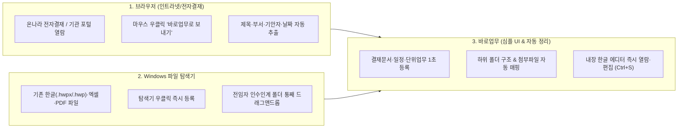
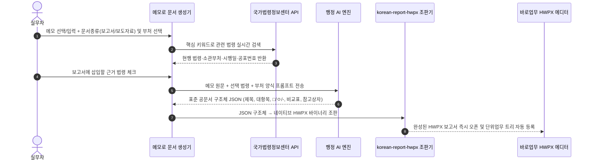
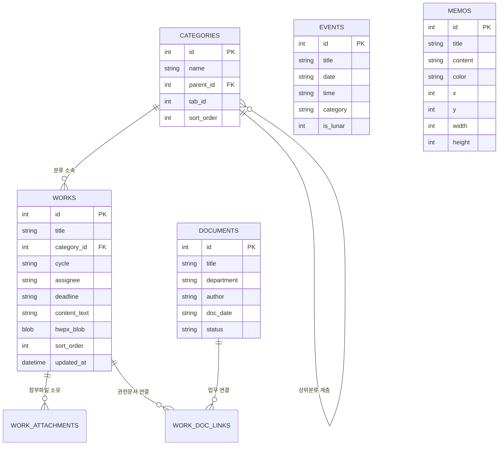
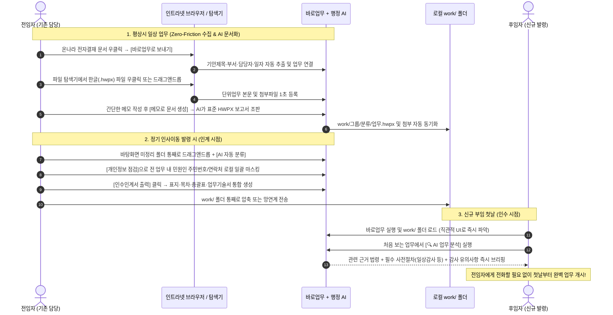

# 📋 [프로그램 정의서] 바로업무 (TaskCalendar)

> **AI 기반 공직사회 순환보직·인사이동 대비 스마트 업무 관리 & 인수인계 종합 행정 솔루션**  
> **공식 명칭**: 바로업무 (TaskCalendar)  
> **현재 버전**: v2.1.5 (2026년 10월 21일 기준)  
> **주요 사용자**: 국가직·지방직 공무원, 공공기관 및 지방공기업 실무자

---

## Ⅰ. 시스템 개요 (System Overview)

### 1. 추진 배경 및 필요성
1. **공직사회 잦은 순환보직의 한계**:
   - 공무원은 1~2년 주기로 정기 인사이동(순환보직)을 겪습니다. 전임자의 구두 설명이나 부실한 한글 파일 몇 장에 의존한 인수인계로 인해 **행정 공백, 민원 지연, 감사 지적**이 반복 발생합니다.
2. **문서(이력)와 업무(지식)의 혼선 해소**:
   - 기존 행정망(온나라, e호조 등)의 데이터는 결재가 끝난 '문서 이력'에 불과합니다. 실무자에게 진정으로 필요한 것은 **"이 일을 언제, 누구와, 어떤 법령에 따라, 무슨 서식으로 처리해야 하는가"**에 대한 실무 지식(Know-how)입니다.
3. **실무 동선 무마찰(Zero-Friction) 접근성과 행정 특화 AI의 결합**:
   - 아무리 좋은 프로그램도 데이터를 넣기 불편하면 현장에서 외면받습니다. 바로업무는 공무원이 하루 종일 사용하는 **인트라넷 웹 브라우저(전자결재)**와 **Windows 파일 탐색기**에서 클릭 한 번, 드래그 한 번으로 업무를 수집하고, **행정 특화 AI 기능**으로 공문서 다듬기·보고서 조판·업무 자동 분류까지 원스톱으로 처리합니다.

### 2. 핵심 비전 및 4대 설계 철학
> **"별도로 공부할 필요 없는 직관적인 UI, 브라우저·탐색기 어디서나 1초 만에 연결되는 접근성, 그리고 AI 행정 비서"**

* **무마찰 접근성 (Zero-Friction Accessibility)**: 프로그램을 일부러 열지 않아도 웹 브라우저(전자결재) 우클릭, 파일 탐색기 우클릭, 폴더 통째 드래그 앤 드롭만으로 기존 업무 자료가 즉시 등록됩니다.
* **직관적이고 완성도 높은 UI/UX (Simple UI, High Completeness)**: 매뉴얼 없이도 누구나 즉시 사용할 수 있는 간결하고 통일감 있는 인터페이스 위에 세밀한 편의 기능을 빈틈없이 구현했습니다.
* **실무 밀착형 행정 AI (AI-Powered Public Admin)**: 에디터 우클릭 개조식 변환, 메모→HWPX 보고서 자동 조판, 문서 삽입용 시각 이미지 생성, 법령·감사 리스크 분석, 인수인계 폴더 AI 자동 분류 등 공무원 실무에 직결되는 AI 기능을 탑재했습니다.
* **파일이 본체인 영구 보존 (File-as-Master & Air-Gapped)**: 모든 업무 데이터는 실제 `.hwpx` 파일과 첨부 폴더로 디스크에 1:1 동기화되며, 오프라인 환경에서도 100% 완벽 동작합니다.

---

## Ⅱ. 시스템 아키텍처 및 기술 스택

### 1. 기술 스택 (Technology Stack)

| 구분 | 적용 기술 및 라이브러리 | 적용 목적 및 특징 |
|---|---|---|
| **Language** | Python 3.12 / 3.14 | 고성능 데스크톱 로직 및 OS 네이티브 제어 |
| **GUI Framework** | PySide6 (Qt 6.7+) | 크로스플랫폼 벡터 렌더링, High-DPI(150%) 최적화, 모던 UI/UX |
| **OS Integration** | Windows Shell & Registry IPC | 파일 탐색기 우클릭 컨텍스트 메뉴, 폴더/파일 드래그앤드롭, `taskcalendar://` 프로토콜 |
| **Browser Engine** | Chrome Extension (Manifest V3) | 인트라넷/전자결재 DOM 스마트 파서(v2.1), 사이트별 요소 피커, 웹 페이지 포스트잇 |
| **Report Builder** | `korean-report-hwpx` + AI | 메모/AI JSON 구조를 부처별 표준 HWPX 보고서·보도자료로 네이티브 조판 |
| **Document Engine** | `rhwp-studio` (WebAssembly) | 로컬 WASM 기반 한글(HWPX) 네이티브 렌더링/편집 및 인라인 AI 플로팅 패널 |
| **Vector Graphics** | `QSvgRenderer` (Qt6 SVG) | AI가 생성한 문서용 일러스트·아이콘 SVG를 고해상도 투명 PNG로 변환·본문 삽입 |
| **Typography** | Pretendard TTF (OFL-1.1) | DirectWrite 기반 고해상도 글꼴 가독성 및 미려한 렌더링 |
| **Database** | SQLite3 | 무손실 스냅샷 백업, 초경량 로컬 트랜잭션 |

---

### 2. 전체 시스템 아키텍처 구성도

```mermaid
flowchart TB
    subgraph EntryPoints["실무자 일상 접점 (Zero-Friction 진입 채널)"]
        INTRA["행정 인트라넷 / 온나라 전자결재 (웹 브라우저)"]
        EXP["Windows 파일 탐색기 (한글 .hwpx/.hwp 파일 및 폴더)"]
        DESK["바탕화면 플로팅 포스트잇 메모"]
    end

    subgraph Client["바로업무 데스크톱 코어 (Windows 10/11)"]
        subgraph UI["직관적·고완성도 Qt6 GUI"]
            MW["메인 윈도우 (월간 캘린더 & 통합 뷰)"]
            WM["단위업무 관리 및 인수인계 편람"]
            DOC["전자결재 문서 이력 관리자"]
            DC["행정 실무 날짜/기한 계산기 4종"]
        end

        subgraph AIEngine["공직 행정 특화 AI 스마트 기능"]
            AIEDIT["에디터 인라인 AI 도우미 (4대 개조식 프리셋 & 11개국 번역)"]
            AIDOC["AI 메모 → HWPX 공문서(보고서·보도자료) 자동 조판기"]
            AIANA["AI 업무/법령/감사 리스크 분석기"]
            AICLS["인수인계 폴더/문서 AI 스마트 자동 분류기"]
            AISVG["문서 작성용 AI 이미지·아이콘 생성기 (SVG→PNG)"]
        end

        subgraph DocEngine["독립 HWPX 문서 & 보안 엔진"]
            WASM["rhwp-studio WebAssembly 한글 에디터"]
            KRHWPX["korean-report-hwpx 조판 엔진"]
            PII["정규식 기반 전 업무 개인정보(PII) 점검·마스킹"]
        end

        subgraph Storage["로컬 스토리지 (File-as-Master)"]
            DB[("SQLite DB (taskcalendar.db)")]
            WORK["실제 문서 저장소 (work/그룹/분류/업무.hwpx)"]
            ATT["첨부파일 보관함 (work/attach/...)"]
        end
    end

    INTRA -->|"우클릭 1초 전송 (taskcalendar://)"| DOC
    INTRA -->|"일정·업무·웹메모 직결"| MW
    EXP -->|"탐색기 우클릭 등록 / 폴더째 드래그앤드롭"| WM
    DESK -->|"메모로 HWPX 보고서 즉시 생성"| AIDOC

    WM <--> AIEngine
    WM <--> DocEngine
    WM <--> WORK
    WM <--> ATT
    UI <--> DB
```



---

## Ⅲ. 핵심 셀링포인트 ①: 압도적 접근성(Zero-Friction) 및 고완성도 UI/UX

> [!TIP]
> **"기능은 강력하지만 화면은 놀라울 만큼 심플하고, 내가 일하는 곳(브라우저·탐색기) 어디서든 즉시 연결됩니다."**  
> 바로업무는 공무원이 기존 업무 습관을 바꾸거나 프로그램을 별도로 학습할 필요가 없도록 **실무 동선 그 자체에 녹아드는 접근성**을 구현했습니다.



---

### 1. 행정 인트라넷·전자결재 웹 브라우저 1초 연동 (`chrome_extension`)
공무원의 업무 80% 이상은 웹 브라우저 기반의 **행정 인트라넷(온나라 전자결재, 새올행정시스템, 기관 내부 포털, 웹메일)**에서 이루어집니다.

* **전자결재·게시판 스마트 추출 엔진 v2.1 (`extractRowData`)**:
  - 브라우저에서 전자결재 문서 목록이나 공지사항 행 위에 마우스를 올리고 **우클릭 → `[바로업무로 보내기]`**만 누르면, 스마트 DOM 분석기가 **문서 제목, 기안 부서, 기안자(담당자), 결재/등록일자, 진행 상태, 문서 URL**을 자동으로 발라내어 바로업무의 `[결재문서 관리]`, `[일정]`, `[단위업무]`로 즉시 전송합니다.
  - **보안 설계**: 결재 문서의 민감한 본문 내용은 추출하지 않고 관리용 메타데이터(제목·기안자·부서·일자)만 안전하게 연동합니다.
* **기관별 인트라넷 맞춤 ‘화면 요소 피커’ (`btn-pick-element` & `siteRule`)**:
  - 부처·지자체·공공기관마다 인트라넷 웹페이지 구조가 달라도 걱정 없습니다. 확장프로그램의 **`[화면 요소 직접 찍기]`** 기능으로 제목·부서·날짜 위치를 마우스로 한 번만 찍어주면 해당 도메인 전용 추출 규칙이 자동 저장되어 어떤 인트라넷이든 100% 호환됩니다.
* **웹페이지 포스트잇 메모 & 양방향 복원**:
  - 자주 보는 인트라넷 매뉴얼이나 법령 페이지 위에 바로 포스트잇 메모를 붙여두고, 데스크톱 앱과 **양방향(내보내기/가져오기)으로 100% 동기화**할 수 있습니다.

---

### 2. Windows 파일 탐색기 네이티브 통합 & 폴더 통째 드래그 앤 드롭
PC 바탕화면이나 폴더에 흩어져 있는 기존 한글 파일들을 프로그램 안으로 가져오는 과정이 극도로 간편합니다.

* **Windows 탐색기 우클릭 컨텍스트 메뉴 직결 (`ExplorerFileImportDialog`)**:
  - 프로그램을 먼저 실행해서 `[파일 열기]` 창을 뒤질 필요가 없습니다.
  - Windows 파일 탐색기에서 기존에 작성한 한글 문서(`.hwpx`, `.hwp`), PDF, 엑셀, 워드 파일이나 폴더를 **마우스 우클릭**하면 나타나는 **`[바로업무 업무로 등록]`** / **`[바로업무 첨부파일로 등록]`** 메뉴로 1초 만에 등록됩니다.
* **파일 및 폴더 통째로 드래그 앤 드롭 (Drag & Drop)**:
  - **개별/다중 파일 드래그**: 탐색기에서 한글 파일들을 마우스로 끌어다 바로업무 화면에 놓기만 하면 즉시 단위업무 본문(HWPX 네이티브 표시) 및 원본 첨부파일로 등록됩니다.
  - **폴더 통째로(하위 폴더 포함) 일괄 등록**: 전임자에게 받은 인수인계 폴더를 **통째로 끌어다 놓거나 불러오면**, 하위 폴더 계층 구조와 인접 첨부파일 폴더(`_첨부파일`, `_files`)까지 자동으로 인식하여 한 번에 수십~수백 개의 단위업무 트리를 완성합니다.

---

### 3. 간결하고 직관적인 UI/UX와 세밀한 완성도 (High Completeness)
누구나 처음 켜자마자 설명서 없이 바로 쓸 수 있도록 **시각적 복잡도는 덜어내고, 실무 편의 디테일은 극대화**했습니다.

* **군더더기 없는 모던 행정 UI 디자인 시스템**:
  - 불필요한 장식과 복잡한 메뉴 계층을 제거하고, **32px 표준 컴포넌트 규격**과 고해상도 **Pretendard 서체**, 눈이 편안한 테마 팔레트(라이트/다크/파스텔)로 통일감 있는 화면을 제공합니다.
* **외부 한글 프로그램이 필요 없는 올인원 HWPX 워크스페이스**:
  - 업무 트리를 클릭하는 즉시 우측 내장 한글(HWPX) 에디터에서 문서가 열리며, 수정 후 **`Ctrl+S` (한글 입력 상태 `ㅁ`에서도 완벽 동작)**만 누르면 실제 디스크 파일까지 즉시 저장됩니다.
* **사용자 배려형 마이크로 UX 디테일**:
  - **바탕화면 자석 스냅 & 스마트 피트**: 플로팅 메모를 화면 모서리에 가져가면 자석처럼 달라붙고, 우측 하단 그립을 **더블클릭하면 여백 없이 글자 크기에 딱 맞게 창 크기가 자동 조절**됩니다.
  - **화면 밖 이탈 방지**: 모니터 해상도나 배율(150% DPI 등)이 바뀌어도 창이 화면 밖으로 넘어가지 않도록 자동 보정합니다.

---

## Ⅳ. 핵심 셀링포인트 ②: 공직 행정 특화 AI 스마트 기능 (AI-Powered Public Admin)

> [!IMPORTANT]
> **바로업무의 AI는 단순한 채팅봇이 아닙니다.**  
> 한글(HWPX) 에디터와 업무 트리에 깊숙이 결합되어, 공무원이 매일 겪는 **공문서 개조식 다듬기, 메모 기반 보고서 자동 조판, 문서 삽입용 시각 이미지 생성, 법령·감사 리스크 진단, 인수인계 폴더 자동 분류**를 원클릭으로 해결하는 **실무 밀착형 행정 AI**입니다.


---

### 1. HWPX 에디터 인라인 AI 도우미 & 우클릭 문장 가공 (`qt_rhwp_editor.py` & `AIChatDialog`)
내장 한글(HWPX) 에디터에서 문장을 드래그하고 **마우스 우클릭 → `[AI 내용 수정 ▸]`**을 누르거나 에디터 내부 **인라인 플로팅 패널(`rhwp-ai-panel`)**을 열어 문서를 즉시 다듬을 수 있습니다.

#### 📌 행정안전부 「행정업무운영 편람」 기준 4대 원클릭 프리셋
1. **`✨ 공문서 개조식 다듬기` (`gongmun`)**:
   - 두서없는 메모나 구어체 문장을 행정안전부 표준 개조식 항목 기호 체계(`1. → □ → ○ → - → ·`)와 명확한 행정 종결어미(`~함`, `~바람`, `~계획임`, `~조치`)로 즉시 변환합니다.
2. **`📋 3줄 핵심 요약` (`summary`)**:
   - 장문의 기안문이나 타 부처 협조문을 상급자·기관장 보고용 **3줄 핵심 요약(① 추진 배경/목적, ② 핵심 내용/실적, ③ 향후 계획/건의사항)**으로 압축합니다.
3. **`⚖️ 관련 법령·규정 검토` (`law`)**:
   - 선택한 문안을 분석하여 **관련 법률·시행령·시행규칙·자치법규(조례·규칙)**, 필수 사전 행정절차, 감사 유의사항을 즉시 도출합니다.
4. **`✍️ 쉬운 공공언어로 순화` (`refine`)**:
   - 문화체육관광부·국립국어원 공공언어 바로쓰기 지침에 따라 권위적 한자어, 외래어, 일본식 투 표현을 바른 공공언어로 다듬고, 하단에 **‘주요 순화 내역(원문 표현 → 순화 표현)’**을 함께 제시합니다.

#### 📌 11개국 다국어 변환 & 3종 행정 전용 번역 스타일 (`open_ai_translate`)
* **지원 언어 (11개국)**: 영어, 중국어(간체), 일본어, 베트남어, 우즈베크어, 러시아어, 태국어, 필리핀어, 몽골어, 스페인어 및 한국어(다국어→한글 역번역).
* **공직 맞춤형 3가지 번역 톤 선택**:
  1. *공문서·행정 안내문 표준 격식체*: 공식 외교·행정 서한 및 고시·공고문용
  2. *외국인 주민·민원인 친절 안내체 (쉬운 표현)*: 다문화 가정·외국인 근로자 민원 안내용
  3. *한글 원문 + 외국어 나란히 병기 (2개 국어)*: 현장 게시물 및 병기 안내문 작성용
* **에디터 본문 원클릭 직결**: 변환된 결과를 복사·붙여넣기 할 필요 없이 **`[선택 영역 교체]`** 또는 **`[커서 위치에 삽입]`** 버튼 한 번으로 한글 문서 본문에 즉시 반영합니다.

---

### 2. AI 메모 → 공문서(보고서·보도자료) HWPX 자동 조판 엔진 (`MemoToReportDialog`)
바탕화면 플로팅 메모나 간단한 아이디어 메모를 바탕으로 **부처별 공식 스타일이 적용된 한글(`.hwpx`) 보고서 및 보도자료 파일**을 통째로 생성합니다.



* **지원 문서 유형 및 양식**:
  - **문서 종류**: 공공기관 개조식 보고서(`report`), 공식 보도자료(`press_release`)
  - **중앙행정기관 및 지자체 맞춤 스타일**: 공통 양식 외 행정안전부, 기획재정부, 과학기술정보통신부, 교육부, 고용노동부 등 기관별 헤드라인·박스·표 스타일 자동 적용.
* **국가법령정보센터 법령 근거표 자동 삽입**:
  - 메모에서 핵심 법령 키워드를 자동 추출하여 법제처 API로 실시간 검색하고, 체크한 법령들을 보고서 하단에 **`[관련 법령 및 근거]` 정식 한글 표(법령명 / 구분·공포번호 / 소관부처·시행일)**로 자동 조판합니다.

---

### 3. 문서 작성 시 필요한 시각 이미지(일러스트·아이콘·도식) AI 실시간 생성기
보고서, 추진계획서, 홍보 안내문, 안전점검표 등을 작성할 때 문서의 완성도를 높여줄 **맞춤형 시각 이미지(일러스트, 픽토그램, 아이콘, 안내 도식 등)**를 외부 이미지 사이트 검색이나 디자인 툴 없이 AI로 즉시 생성하여 본문에 넣을 수 있습니다.

* **작동 메커니즘 (`extract_svg_from_text` & `render_svg_to_png`)**:
  1. 문서 작성 중 AI 도우미에게 *"시설 안전점검 계획서에 넣을 안전모와 체크리스트 일러스트 그려줘"* 또는 *"민원 안내문에 들어갈 친근한 상담 아이콘 만들어줘"*처럼 필요한 그림을 요청합니다.
  2. AI가 요청 맥락에 맞는 깔끔한 벡터 그래픽(`<svg>`)을 즉시 설계합니다.
  3. 내장 `QSvgRenderer` 엔진이 이를 **고해상도 투명 배경 PNG 이미지**로 실시간 렌더링하여 대화창에 미리보기를 보여줍니다.
  4. **`[커서 위치에 삽입]`** 클릭 한 번으로 작성 중인 한글(HWPX) 문서 본문에 선명한 이미지 객체로 즉시 삽입됩니다.

---

### 4. AI 업무 분석기 — 법령·절차·감사 리스크 사전 진단 (`AIAnalyzeDialog`)
전임자로부터 처음 인계받은 낯선 업무나 신규 사업을 추진할 때 **`[🔍 AI 업무 분석]`** 버튼 하나로 문서 전체를 정밀 진단합니다.

1. **📜 관련 근거 법령 및 행정규칙 도출**:
   - 해당 업무의 법적 근거가 되는 법률·시행령·훈령·예규·조례와 필수 확인 조항을 안내합니다.
2. **🔄 필수 행정 절차 및 사전 선결 요건 로드맵**:
   - 실무자가 놓치기 쉬운 **예산 사전검토, 일상감사, 계약심사, 성별영향평가, 개인정보영향평가, 위원회 심의, 행정예고** 등 단계별 필수 절차를 짚어줍니다.
3. **⚠️ 감사 지적 사례 예방 & 실무 체크리스트**:
   - 자체감사 및 정부합동감사 단골 지적 사례(예: 수의계약 분할발주 금지, 정산 증빙 누락 등)와 필수 편철 보존 서류 목록을 제시하며, **`[+ 현재 문서 하단에 분석 결과 삽입]`**으로 인수인계 매뉴얼 본문에 원클릭 보강할 수 있습니다.

---

### 5. AI 스마트 업무 자동 분류기 — 탐색기 파일 & 인수인계 폴더 일괄 정리
전임자가 남기고 간 수백 개의 중구난방 폴더와 문서 파일들을 AI가 단숨에 체계적인 단위업무 트리로 정리해 줍니다.

* **탐색기 우클릭 단일 문서 AI 자동 분류 (`build_auto_classify_messages`)**:
  - 탐색기에서 문서를 가져올 때 **파일명 + 업무명 + 본문 앞부분 스니펫(HWPX XML 내부 텍스트 최대 600자 추출)**을 AI가 읽고 가장 적합한 업무 분류와 **추천 사유(1줄 요약)**를 자동 배정합니다.
* **인수인계 폴더 통째로 AI 일괄 정리 (`build_folder_ai_classify_messages`)**:
  - 전임자의 인수인계 폴더를 통째로 불러올 때, `'새 폴더'`, `'기타'`, `'임시'` 같은 무의미한 폴더명을 자동 걸러내고 폴더 내 전체 파일들의 경로·제목·본문 요약을 한 번에 분석하여 **9대 표준 행정 도메인(`예산·회계`, `계약·구매`, `인사·복무`, `법령·규정`, `민원·행정`, `보안·개인정보`, `기획·보고`, `교육·행사`, `시설·물품`)** 또는 부서 맞춤 분류로 자동 그룹핑합니다.

---

## Ⅴ. 7대 기본 행정 및 문서 보안 기능 상세 명세

```mermaid
mindmap
  root((바로업무<br/>전체 기능 체계))
    압도적 접근성 & UX
      인트라넷·전자결재 1초 연동
      기관별 웹 요소 피커
      탐색기 우클릭 즉시 등록
      폴더·파일 통째 드래그앤드롭
      직관적 미니멀 UI 디자인
    AI 스마트 행정 기능
      에디터 우클릭 4대 개조식 프리셋
      11개국 다국어 & 3종 행정 번역
      메모 → HWPX 보고서 자동 조판
      문서 삽입용 AI 이미지 실시간 생성
      AI 법령·절차·감사 리스크 분석
      인수인계 폴더 AI 자동 분류
    단위업무 & 인수인계
      계층형 업무 분류 트리
      HWPX 내장 리치 에디터
      5대 분야 21종 행정 서식
      공문서 직인·고무인 이미지 템플릿
      인수인계서 원클릭 자동 생성
    문서 보안 & 법령 연계
      전 업무 개인정보(PII) 일괄 마스킹
      본문 법령 자동 감지 배너
      법령 조문 및 신구법 비교
    공직 특화 캘린더 & 계산기
      한국 공휴일/대체공휴일 엔진
      음력(1841~2100) 및 24절기
      민원 처리기한·영업일·근속 계산기
```

---

### 1. 단위업무 관리 및 인수인계 편람
* **단위업무 메타데이터 표준화**: 업무명, 대·중·소 분류, 처리주기(수시, 매일, 주간, 월간, 분기, 반기, 연간), 담당자, 마감시기, 관련 법적근거 등록.
* **공무원 5대 표준 서식 21종 & 공문서 이미지 템플릿 기본 탑재**:
  - 보고서/계획서, 공문/대외협조, 복무/서무행정, 예산/회계/계약, 감사/현장점검 21종 HWPX 표준 서식과 공문서 직인·결재선·고무인 이미지 템플릿 내장.
* **공식 인수인계서 자동 출력**: 표지(인계자·인수자·입회관 서명란), 목차, 단위업무 총람, 단위업무별 세부 기술서, 부서 분장표를 한 권의 보고서로 통합 생성.

### 2. 로컬 정규식 기반 전(全) 업무 개인정보(PII) 점검 및 HWPX 일괄 마스킹 (`work_smart_tools.py`)
* **외부 전송 없는 100% 로컬 정밀 검출 (`detect_personal_info`)**:
  - AI나 외부 서버로 데이터를 보내지 않고, 내장 정규식 엔진이 **8대 개인정보(주민/외국인등록번호, 휴대전화, 일반전화, 이메일, 카드번호, 계좌번호, 차량번호, 민원인 성명)**를 정밀 검출합니다 (공문서 시행번호 `2026-10-12345` 등 행정 번호 오탐 자동 배제).
* **업무 트리 다중 선택 스캔 & HWPX 내부 XML 직접 치환 (`apply_replacements_to_hwpx_blob`)**:
  - 현재 열린 문서뿐만 아니라 업무 트리에서 선택한 수백 개 업무를 한 번에 검사하고, **`[마스킹 / 직접수정 / 유지 / 삭제]`** 지정 시 에디터에 열려 있지 않은 문서까지 **HWPX 압축 컨테이너 내부(`Contents/section*.xml`) 텍스트 노드를 직접 치환·재패키징**하여 일괄 비식별화합니다.

### 3. 국가법령정보센터 실시간 연계 & 본문 법령 자동 감지 배너 (`LawReferenceBanner`)
* 업무 문서를 열거나 작성할 때 본문에 등장하는 법령명(`「개인정보 보호법」 제15조` 등)을 실시간 감지하여 에디터 상단 배너에 알약 버튼으로 띄워주며, 클릭 또는 에디터 우클릭(`[법령 찾기]`) 시 국가법령정보센터(`law.go.kr`) 현행 조문 열람 및 신·구법 비교를 즉시 제공합니다.

### 4. 파일 시스템 기반 영구 보존 (`File-as-Master`)
* **물리적 디렉터리 동기화 구조**: `work/<그룹번호>/<분류계층경로>/<업무명>.hwpx` 및 `work/attach/...`
* 소프트웨어가 없어도 후임자가 Windows 파일 탐색기에서 업무 한글 파일과 첨부자료를 그대로 열람 가능하며, 탐색기에서 변경한 내용도 앱 실행 시 양방향 해시 동기화됩니다.

### 5. 공직 특화 캘린더 & 행정 실무 계산기 4종
* **대한민국 공휴일·음력(1841~2100)·24절기 동적 계산 엔진**: 대체공휴일, 선거일 임시공휴일 및 음력 반복 일정 산정.
* **행정 실무 스마트 계산기 4종**: ① 민원 처리기한 계산기(민원처리법 제19조 완벽 반영), ② 영업일(근무일) 계산기, ③ 일수 & D-Day 기념일 계산기, ④ 만 나이 & 공무원 근속기간(호봉) 계산기.

---

## Ⅵ. 데이터 스토리지 구조



---

## Ⅶ. AI & 무마찰 접근성 기반 공무원 인수인계 실무 시나리오



---

## Ⅷ. 보안 및 망분리 환경 대응 설계

1. **완전한 오프라인 독립 구동 (Air-Gapped Operation)**:
   - 외부 인터넷이 차단된 행정 내부망에서도 내장 HWPX 에디터, 캘린더, 행정 계산기, 로컬 개인정보(PII) 스캐너, 오프라인 보고서 조판기가 일체의 기능 제약 없이 100% 동작합니다.
2. **로컬 기반 개인정보 비식별화**:
   - 전 업무 일괄 개인정보(PII) 점검 도구는 외부 네트워크 통신 없이 사용자 PC 내부에서 정규식 기반으로 동작하여 민원인 주민등록번호·연락처·계좌번호 유출을 원천 예방합니다.
3. **망연계 보안 통과용 WASM 복원 및 계정 독립 복구**:
   - 망연계 시스템에서 `.wasm` 차단 시 표준 PNG(`rhwp_engine.png`) 페이로드에서 자동 복원하며, Windows 계정이 바뀌어도 `.sqlite.bak` 스냅샷과 `work/*.hwpx` 실물 파일로 100% 무손실 복구됩니다.

---

> **문서 버전**: v1.3.0 (2026-10-19 AI 특화 5대 핵심 기능 정교화 및 보안 기능 분리 반영)  
> **작성 기준**: 바로업무(TaskCalendar) v2.1.5 코드베이스 전수 검토 결과 반영  
> **보관 위치**: `docs/프로그램_정의서_바로업무.md`

---

## Ⅸ. 프로그램 버전 및 변경 이력 (Revision History)

| 버전 | 일자 | 주요 변경 내용 및 개선 사항 | 비고 |
|---|---|---|---|
| **v2.1.5** | 2026-10-21 | • 체크박스 배경 박스 및 테두리 프레임 완벽 복원 (흰색 박스 & 흰색 체크마크)<br>• 업무분류 미리보기 테이블 텍스트 Pretendard 서체 일치화 및 글자 크기 정규화<br>• 부모 프레임 스타일 격리로 테이블 테두리 직각화(border-radius: 0px) 및 모서리 깨짐 근본 해결<br>• 모달 내 불필요한 AI 설정 버튼 제거 확인 | UI/UX 개선 |\n| **v2.1.4** | 2026-10-21 | • 업무분류 미리보기 테이블 테두리 직각화(border-radius: 0px)로 모서리 깨짐 완전 해결<br>• 미리보기 테이블 행 글꼴 크기 정규화(11px)로 UI 글자 크기 일관성 확보<br>• 하단 5개 옵션 텍스트 클릭 시 탐색 경로 폴더, 대상 파일 항목 및 기능 정의 안내 팝업(ImportOptionInfoDialog) 및 동기화 토글 지원 | UI/UX 개선 |\n| **v2.1.3** | 2026-10-21 | • 업무 폴더 분석 모달 UI/UX 정밀 고도화<br>- 확장자 선택 체크박스 비주얼 통일(모던 박스 & 흰색 체크마크 checkmark_white.svg 적용)<br>- 업무분류 미리보기 테이블 모서리 곡률(border-radius) 깨짐 및 헤더 경계선 완벽 수정<br>- 미리보기 테이블 행 텍스트 폰트 크기 및 높이 균형 최적화(10.5pt)<br>- 불필요한 'AI 설정' 버튼 제거로 상단 액션 집중도 향상<br>- '• 등록할 파일 형식 선택 (N개)' 동적 개수 실시간 표시<br>- 하단 5개 옵션 체크박스 앞 이모티콘 제거 및 표준 행정 텍스트 정돈 | 소스 및 UI 개선 |
| **v2.1.2** | 2026-10-19 | • 브라우저 페이지 메모관리 팝업 테두리 제거 및 일반 버튼과 디자인 통일<br>• 크롬 확장프로그램 불필요 안내 문구 정리<br>• 저장폴더 열기 버튼 스타일 통일 및 설정 메뉴 '...' 말줄임표 제거<br>• 공무원 인수인계 특화 프로그램 정의서 개편 | UI/UX 개선 |
| **v2.1.1** | 2026-10-16 | • 전자결재 웹 브라우저 익스텐션 연동 강화 (DOM 스마트 파서 v2.1)<br>• 파일 탐색기 우클릭 메뉴 및 단위업무 트리 폴더/파일 Drag & Drop 고도화 | 연동성 강화 |
| **v2.1.0** | 2026-10-10 | • 공직 행정 특화 5대 AI 기능 정식 탑재<br>- 에디터 인라인 AI 도우미 (4대 개조식 프리셋 & 11개국 번역)<br>- AI 메모 → HWPX 표준 공문서/보고서/보도자료 자동 조판<br>- 문서 작성용 맞춤 이미지·아이콘 SVG→PNG 생성기<br>- 폴더/문서 AI 자동 분류기 및 법령·감사 리스크 진단기 | AI 기능 혁신 |
| **v2.0.0** | 2026-10-01 | • High-DPI(150%) 고해상도 최적화 및 프리텐다드(Pretendard) 서체 적용<br>• 로컬 WASM 기반 한글(HWPX) 네이티브 에디터(
hwp-studio) 통합 | UI 및 엔진 개편 |
