# [2026 공공 AI 대전환 챌린지] AI 영상 생성용 카메라 앵글별 세부 샷 콘티_261023

- **출품 과제**: 세션 2 지정과제 ① [업무바통(인수인계)]
- **작품명**: 세션2 업무바통 바로업무 - 온나라 연계 AI 인수인계 솔루션 (v2.1.5)
- **목적**: Runway Gen-3, Luma Dream Machine, Kling, Sora 등 **생성형 비디오 AI 및 AI 편집 툴에 즉시 입력 가능한 컷(Shot) 단위 정밀 프롬프트 명세서**
- **전체 구성**: 총 24개 세부 샷 (총 재생시간 약 3분 15초 / 195초)
- **포함 규격**: 카메라 앵글/무빙, 비주얼 묘사, 톤앤매너, **AI 영상 생성용 영문 프롬프트(Video Gen Prompt)**, 나레이션 음성 대본, 자막, 효과음

---

## 🎬 씬 & 샷(Shot) 구성도 및 카메라 워크 요약

```mermaid
flowchart TD
    subgraph S1["씬 1: 오프닝 (샷 1~3, 20초)"]
        Shot1["샷 1 (6초): 와이드 풀샷 (야근 사무실)"]
        Shot2["샷 2 (7초): 오버 더 숄더 클로즈업 (복잡한 폴더들)"]
        Shot3["샷 3 (7초): 푸시인 돌리 (바로업무 1초 기동)"]
    end
    subgraph S2["씬 2: 1단계 업무·AI (샷 4~9, 50초)"]
        Shot4["샷 4 (8초): 탑다운 화면 (인수인계 폴더 드래그&드롭)"]
        Shot5["샷 5 (8초): 매크로 클로즈업 (30개 계층 트리 자동 생성)"]
        Shot6["샷 6 (8초): UI 플랫 샷 (불용품처분계획 HWPX 본문·첨부)"]
        Shot7["샷 7 (8초): 마이크로 줌인 (참조 법령 공유재산법 65조 클릭)"]
        Shot8["샷 8 (10초): 스플릿 스크린 (AI 법령 대조 분석 실행)"]
        Shot9["샷 9 (8초): 하이라이트 샷 (누락 조항 자동 수정 반영)"]
    end
    subgraph S3["씬 3: 2단계 일정·메모 (샷 10~13, 38초)"]
        Shot10["샷 10 (8초): 앵글 틸트 (일정등록 ➔ 캘린더 11.13 연동)"]
        Shot11["샷 11 (10초): 익스트림 클로즈업 (공휴일 동적계산 & 음력 표기)"]
        Shot12["샷 12 (10초): 팝업 모션 샷 (플로팅 메모 바탕화면 분리)"]
        Shot13["샷 13 (10초): 드래그 줌인 (비상연락망 화면 캡처 박제)"]
    end
    subgraph S4["씬 4: 3단계 온나라 연계 (샷 14~18, 45초)"]
        Shot14["샷 14 (8초): 모니터 투 샷 (온나라 모의 결재함 웹페이지)"]
        Shot15["샷 15 (8초): 마우스 핑거 매크로 샷 (우클릭 '바로업무로 보내기')"]
        Shot16["샷 16 (10초): 트랜지션 슬라이드 (열린 카드로 기안문·결재선 적재)"]
        Shot17["샷 17 (10초): 버튼 인터랙션 (상단 '메모로 문서 생성' 클릭)"]
        Shot18["샷 18 (9초): 뷰어 풀 스크린 (행안부 표준 HWPX 초안 완성)"]
    end
    subgraph S5["씬 5: 실전 검증 & 보안 (샷 19~22, 30초)"]
        Shot19["샷 19 (7초): 페이드 줌 (온나라 지식 8,230회 돌파 엠블럼)"]
        Shot20["샷 20 (8초): 슬라이드 패닝 (전국 공직자 감사 댓글 피드백)"]
        Shot21["샷 21 (8초): 엠보싱 3D 샷 (타 부처 감사 메일 및 환류)"]
        Shot22["샷 22 (7초): 보안 대시보드 샷 (공공 GitLab 5대 검증 PASS)"]
    end
    subgraph S6["씬 6: 엔딩 & 비전 (샷 23~24, 15초)"]
        Shot23["샷 23 (8초): 3D 모션 그래픽 (10일 ➔ 1시간 단축 그래프)"]
        Shot24["샷 24 (7초): 시네마틱 락 샷 (공식 타이틀 엠블럼)"]
    end

    S1 --> S2 --> S3 --> S4 --> S5 --> S6
```



---

## 🎥 샷별 세부 카메라 연출 및 생성 프롬프트

---

### [씬 1] 오프닝: 인사이동의 현실 (00:00 ~ 00:20 / 20초)

#### 샷 1-1 (00:00 ~ 00:06 / 6초)
* **카메라 앵글 & 무빙**: 와이드 풀 샷(Wide Full Shot), 느린 슬로우 줌인(Slow Zoom-in).
* **장면 묘사**: 늦은 밤 불이 켜진 대한민국 공공기관 사무실 전경. 책상 위에는 공문서 서류 뭉치가 쌓여 있고 지친 공무원이 모니터를 응시하고 있음. 차분하고 다소 무거운 감성.
* **조명/톤**: 어두운 블루/앰버 톤, 모니터 불빛에 반사된 인물 실루엣.
* **비디오 AI 영문 프롬프트**:
  ```text
  Cinematic wide shot of a tired Korean government office worker sitting at a desk late at night, surrounded by stacks of official document folders and papers. Dim moody office ambient lighting, subtle glow from computer monitor on face. Realistic documentary style, 4k resolution, 60fps, slow push-in camera movement.
  ```
* **음성 나레이션**: "인사이동 때마다 전임자가 남긴 수천 개의 파일 속에서 길을 잃고,"
* **화면 자막**: `[인사이동의 현실] 파편화된 문서 폴더와 끊어진 실무 맥락`
* **효과음(SFX)**: 조용한 사무실 앰비언스, 무거운 피아노 저음.

#### 샷 1-2 (00:06 ~ 00:13 / 7초)
* **카메라 앵글 & 무빙**: 오버 더 숄더 클로즈업(Over-the-Shoulder Close-Up), 핸드헬드 느낌의 미세한 흔들림.
* **장면 묘사**: 컴퓨터 모니터 화면 가득 어지럽게 열려 있는 윈도우 파일 탐색기. `새 폴더(3)`, `2024_예산안_진짜최종_수정.hwp` 등 수백 개의 파일이 정렬되지 않은 채 혼란스러운 상태.
* **비디오 AI 영문 프롬프트**:
  ```text
  Over-the-shoulder close-up shot focused on a Windows PC screen. Cluttered desktop and multiple messy Windows Explorer windows open with hundreds of chaotic files named in Korean, yellow folder icons scattered everywhere. Confusing document chaos, ultra-sharp screen capture detail, natural slight handheld camera motion.
  ```
* **음성 나레이션**: "배경조차 알 수 없는 기안문과 누락된 절차 때문에 야근하셨습니까?"
* **화면 자막**: `배경을 알 수 없는 수천 개의 파일과 끝없는 야근`
* **효과음(SFX)**: 신경질적인 마우스 휠 스크롤 소리와 클릭음.

#### 샷 1-3 (00:13 ~ 00:20 / 7초)
* **카메라 앵글 & 무빙**: 프론트 뷰 푸시인(Frontal Push-in Dolly), 중앙 고정.
* **장면 묘사**: 마우스가 바탕화면의 `바로업무.exe` 아이콘을 빠르게 더블클릭하자, 화면이 환해지며 현대적이고 깔끔한 바로업무 메인 대시보드 UI가 1초 만에 매끄럽게 페이드인되며 등장.
* **조명/톤**: 화면 전체가 밝고 청량한 블루/화이트 톤으로 급전환.
* **비디오 AI 영문 프롬프트**:
  ```text
  Clean digital screen recording shot. Mouse cursor swiftly double-clicks an icon labeled '바로업무.exe'. Instantly within 1 second, a modern, beautifully designed Korean government Task & Calendar dashboard application interface opens with smooth 60fps animation. Crisp typography, navy and teal modern UI accents, clean studio lighting.
  ```
* **음성 나레이션**: "폴더 체계를 그대로 살리고 전자결재와 법령까지 단 1초 만에 이어주는 솔루션, 『업무바통 바로업무』입니다."
* **화면 자막**: `[솔루션] 온나라 연계 AI 인수인계 솔루션 『업무바통 바로업무』`
* **효과음(SFX)**: 경쾌한 더블클릭 소리 ➔ 청량한 UI 부팅음(`슉- 딩!`).

---

### [씬 2] 1단계: 업무 인수인계 & AI 법령 대조 (00:20 ~ 01:10 / 50초)

#### 샷 2-1 (00:20 ~ 00:28 / 8초)
* **카메라 앵글 & 무빙**: 탑다운 버드아이 뷰(Top-Down Bird's Eye View) ➔ 스크린 정면 트랜지션.
* **장면 묘사**: 상단 메뉴의 [업무] 탭을 클릭. 우측 탐색기의 `04_모의데이터_인수인계샘플` 폴더를 마우스로 잡고 프로그램 좌측 업무 트리 영역으로 부드럽게 드래그&드롭. 팝업창에서 [모두 덮어쓰기] → [인수인계 시작] 버튼 클릭.
* **비디오 AI 영문 프롬프트**:
  ```text
  Screen capture animation of a modern desktop application. A yellow folder icon is smoothly dragged from Windows Explorer and dropped directly into the left sidebar of the application. A sleek modern modal popup appears asking for confirmation, and the blue button '인수인계 시작' is clicked by the mouse cursor. 4K, crisp UI motion graphic.
  ```
* **음성 나레이션**: "첫 번째, '업무 인수인계와 AI 법령 검토' 단계입니다. 전임자의 폴더를 끌어다 놓기만 하면,"
* **화면 자막**: `[원클릭 바통터치] 전임자 인수인계 폴더 드래그 & 드롭`
* **효과음(SFX)**: 묵직하고 깔끔한 드롭 음(`탁!`).

#### 샷 2-2 (00:28 ~ 00:36 / 8초)
* **카메라 앵글 & 무빙**: 좌측 사이드바 패널 매크로 줌인(Macro Zoom-in).
* **장면 묘사**: 드롭과 동시에 하단에 '서무복무', '예산회계', '현안사업' 3개 그룹 탭이 생겨나고, 12개 분류와 30개 단위업무가 계층적 트리 구조로 순식간에 펼쳐지는 애니메이션.
* **비디오 AI 영문 프롬프트**:
  ```text
  Macro close-up on the left navigation panel of the software. Instantaneous auto-generation of nested hierarchy tree view showing 3 bottom tabs (서무복무, 예산회계, 현안사업) and 30 organized task rows unfolding downwards smoothly. High-tech responsive UI visualization, clean Korean typography.
  ```
* **음성 나레이션**: "1초 만에 대분류, 중분류, 단위업무의 계층 구조로 즉시 복원됩니다."
* **화면 자막**: `1초 만에 3개 업무 그룹 & 30개 단위업무 계층 트리 완벽 복원`
* **효과음(SFX)**: 카드가 촤르륵 정렬되는 기계적 인터랙션 음(`촤라락-`).

#### 샷 2-3 (00:36 ~ 00:44 / 8초)
* **카메라 앵글 & 무빙**: 메인 뷰어 영역 팬 라이트(Pan Right) 무빙.
* **장면 묘사**: 마우스가 트리에서 `1/물품자산/불용품처분계획.hwpx`를 클릭. 화면 중앙에 정식 공문서 본문이 선명하게 로딩되고, 우측 패널에는 첨부파일 2건(물품조사서, 감정평가서)과 북마크가 나타남.
* **비디오 AI 영문 프롬프트**:
  ```text
  Smooth camera pan across the desktop software workspace. Clicking on an item labeled '불용품처분계획' instantly renders a formal Korean public document (HWPX layout with tables and official stamps) in the center viewer, while the right sidebar displays two attached files with file icons and bookmark links.
  ```
* **음성 나레이션**: "불용품 처분 문서를 열어보겠습니다. 공문 본문과 증빙 첨부파일이 완벽히 보존되어 있습니다."
* **화면 자막**: `[내장 편람] 공문서 본문(HWPX) + 증빙 첨부 2건 + 북마크 4-in-1 일체형 보존`
* **효과음(SFX)**: 파일 열리는 효과음(`착-`).

#### 샷 2-4 (00:44 ~ 00:52 / 8초)
* **카메라 앵글 & 무빙**: 상단 배너 익스트림 클로즈업(Extreme Close-Up).
* **장면 묘사**: 본문 상단에 파란색으로 떠 있는 [참조 법령: 공유재산 및 물품 관리법 제65조] 배너. 마우스 커서가 배너 위에 올라가면 은은한 하이라이트 효과가 나타나며 클릭.
* **비디오 AI 영문 프롬프트**:
  ```text
  Extreme close-up shot on the top notification banner of the document editor. Text reads '참조 법령: 공유재산 및 물품 관리법 제65조' with a glowing blue badge. Mouse cursor hovers over it with a smooth highlight pulse and clicks. Ultra-sharp UI detailing.
  ```
* **음성 나레이션**: "여기서 상단의 'AI 법령 대조'를 실행합니다."
* **화면 자막**: `국가법령정보센터(DRF API) 실시간 연동 배너 클릭`
* **효과음(SFX)**: 하이라이트 비프음(`띵`).

#### 샷 2-5 (00:52 ~ 01:02 / 10초)
* **카메라 앵글 & 무빙**: 분할 화면(Split Screen) 와이드 샷 ➔ 중앙 AI 팝업 포커스.
* **장면 묘사**: AI 분석 대화상자가 열리며, 좌측에는 '내 업무 문서 내용', 우측에는 '국가법령정보센터 조문 원문'이 나란히 표시됨. AI 로딩 스피너가 돌고 "매각 심의위원회 의결 누락", "내용연수 미달 품목 처분 사유 미비" 2개 항목에 빨간색 경고 딱지가 붙음.
* **비디오 AI 영문 프롬프트**:
  ```text
  Split-screen UI modal dialogue showing AI legal compliance analyzer. Left side compares local document text against official South Korean national law text on the right side. AI scanning beam animation runs across the text, instantly detecting two regulatory discrepancies highlighted with red warning icons and clear Korean explanations.
  ```
* **음성 나레이션**: "AI는 국가법령정보의 최신 조문과 대조하여, 누락된 심의 절차를 스스로 찾아내고"
* **화면 자막**: `[AI 법령 분석] 최신 법령 조문 대조 ➔ 누락 절차 2건 자동 감지`
* **효과음(SFX)**: AI 스캔 음(`샤-앙`), 오류 감지 경고음(`두둥!`).

#### 샷 2-6 (01:02 ~ 01:10 / 8초)
* **카메라 앵글 & 무빙**: 하단 액션 버튼 클로즈업 ➔ 본문 줌아웃(Zoom-out).
* **장면 묘사**: 모달 하단의 [선택한 항목만 문서에 반영] 버튼 클릭. 본문 공문서의 누락되었던 심의위원회 조항 칸에 법령 표준 문구가 초록색으로 자동 채워지며 완벽한 기안문으로 교정됨.
* **비디오 AI 영문 프롬프트**:
  ```text
  Close-up of clicking a green action button labeled '선택한 항목만 문서에 반영'. Camera pulls back slightly to show the main document automatically updating its legal clause section, replacing missing procedural text with correct formal administrative phrasing in real time.
  ```
* **음성 나레이션**: "정식 공문서 양식으로 즉시 교정해 줍니다."
* **화면 자막**: `누락 절차 표준 문구 본문 즉시 반영 및 문서 자동 교정`
* **효과음(SFX)**: 성공 완료 차임벨(`반짝- Chime`).

---

### [씬 3] 2단계: 일정 연계 & 플로팅 메모 (01:10 ~ 01:48 / 38초)

#### 샷 3-1 (01:10 ~ 01:18 / 8초)
* **카메라 앵글 & 무빙**: 앵글 틸트 다운(Tilt-Down) ➔ 메인 캘린더 탭 전환.
* **장면 묘사**: 업무 상세창 좌측 상단의 [일정등록] 버튼 클릭. 확인 팝업 후 상단 메인 메뉴의 [캘린더] 탭을 누르자, 11월 13일 날짜 칸에 보라색 스티커와 함께 『물품심사위원회 개최 (14:00)』 일정이 등록됨.
* **비디오 AI 영문 프롬프트**:
  ```text
  UI interaction shot. Clicking '일정등록' on the task window smoothly schedules an event. Transition to the main monthly calendar view tab. On November 13th box, an event tag labeled '물품심사위원회 개최' pops up with a stylish purple calendar sticker badge.
  ```
* **음성 나레이션**: "두 번째는 '일정과 메모의 입체 연계'입니다. 업무에 포함된 중요 행사는 클릭 한 번으로 메인 캘린더에 연동되며,"
* **화면 자막**: `[일정 연계] 단위업무의 중요 행사 ➔ 월간 캘린더 원클릭 전송`
* **효과음(SFX)**: 경쾌한 일정 등록 음(`딸깍- 톡`).

#### 샷 3-2 (01:18 ~ 01:28 / 10초)
* **카메라 앵글 & 무빙**: 캘린더 특정 날짜 셀 익스트림 클로즈업(Extreme Close-Up).
* **장면 묘사**: 캘린더 날짜 셀 안의 디테일 줌인: 빨간색으로 표시된 법정공휴일, 우측 상단의 대체공휴일 라벨, 작고 선명한 음력 날짜(10.5)와 24절기(입동) 텍스트가 정밀하게 조명됨.
* **비디오 AI 영문 프롬프트**:
  ```text
  Macro shot of a modern digital calendar grid cell. Intricate details visible: dynamic calculation of South Korean official public holidays in soft red font, lunar calendar dates (음력), and 24 solar terms (절기) crisply rendered with elegant Pretendard font. High aesthetics.
  ```
* **음성 나레이션**: "대한민국 전체 법정공휴일과 대체공휴일, 음력까지 자동 계산되어 빈틈이 없습니다."
* **화면 자막**: `[공직 특화 캘린더] 전체 법정·대체공휴일 동적 계산 및 음력/24절기 지원`
* **효과음(SFX)**: 미세하고 부드러운 앰비언트 신스 음.

#### 샷 3-3 (01:28 ~ 01:38 / 10초)
* **카메라 앵글 & 무빙**: 팝업 모션 와이드 샷(Pop-out Motion Wide Shot).
* **장면 묘사**: 메인 화면 우측 상단의 [플로팅 메모] 아이콘 클릭. 노란색 세련된 포스트잇 스타일의 메모 위젯이 캘린더 창에서 퐁 튀어나와 윈도우 바탕화면 오른쪽 상단에 항상 최상위(Always-on-top)로 안착.
* **비디오 AI 영문 프롬프트**:
  ```text
  Action shot of a floating sticky note widget popping out from the main calendar application. The yellow translucent note window detaches smoothly and docks onto the top right corner of the Windows desktop, maintaining an always-on-top floating state above other background applications.
  ```
* **음성 나레이션**: "수시로 확인해야 하는 실무 지침과 비상연락망은 '바탕화면 플로팅 메모'로 분리할 수 있습니다."
* **화면 자막**: `[플로팅 메모] 업무 방해 없는 독립 바탕화면 위젯 분리`
* **효과음(SFX)**: 팝업 분리 음(`퐁- Pop`).

#### 샷 3-4 (01:38 ~ 01:48 / 10초)
* **카메라 앵글 & 무빙**: 메모 상단 툴바 매크로 줌인 ➔ 화면 캡처 애니메이션.
* **장면 묘사**: 플로팅 메모 상단의 [캡처] 아이콘 클릭 ➔ 화면이 살짝 어두워지며 십자 커서로 화면의 '부서 비상연락망 및 당직표'를 사각형 드래그. 드래그를 놓자마자 메모 본문 안에 고화질 캡처 이미지가 1초 만에 박제됨.
* **비디오 AI 영문 프롬프트**:
  ```text
  Screen capture tool demonstration. A crosshair mouse cursor drags a glowing rectangular selection box over an emergency contact phone directory on the screen. Upon release, the selected screen snapshot instantly pastes directly inside the floating memo note with crystal clarity.
  ```
* **음성 나레이션**: "화면 캡처 기능을 통해 다른 작업을 하면서도 중요 참고 자료를 항상 곁에 두고 볼 수 있습니다."
* **화면 자막**: `[화면 캡처 박제] 비상연락망·긴급지침 원클릭 이미지 박제`
* **효과음(SFX)**: 셔터 효과음(`찰칵!`).

---

### [씬 4] 3단계: 온나라 결재 연동 & 표준 HWPX 생성 (01:48 ~ 02:33 / 45초)

#### 샷 4-1 (01:48 ~ 01:56 / 8초)
* **카메라 앵글 & 무빙**: 모니터 투 샷(Screen Two-Shot) 또는 브라우저 화면 풀 샷.
* **장면 묘사**: 크롬 브라우저로 온나라 전자결재 모의 사이트 실행. 실제 정부 온나라 포털과 똑같은 공문서 결재 화면에서 '2026년도 하반기 정기 재물조사 결과 보고' 기안문이 열려 있는 모습.
* **비디오 AI 영문 프롬프트**:
  ```text
  Web browser view showing a realistic South Korean government e-approval system ('온나라' electronic document system). Official approval document layout displaying document title, drafter information, and approval workflow stamps on top right.
  ```
* **음성 나레이션**: "세 번째, 공무원의 주 무대인 '온나라 전자결재 연동'입니다."
* **화면 자막**: `[온나라 전자결재] 공직 업무 포털 실시간 스크랩 연동`
* **효과음(SFX)**: 웹 브라우저 로딩 음.

#### 샷 4-2 (01:56 ~ 02:04 / 8초)
* **카메라 앵글 & 무빙**: 마우스 우클릭 컨텍스트 메뉴 익스트림 클로즈업.
* **장면 묘사**: 온나라 결재문서 본문 위에서 마우스 우클릭. 나타난 윈도우 메뉴에서 [바로업무로 보내기] (파란색 바로업무 아이콘, 단축키 `Ctrl+Shift+K`) 항목을 마우스가 호버하고 클릭.
* **비디오 AI 영문 프롬프트**:
  ```text
  Extreme close-up on the mouse cursor right-clicking inside the web browser. A context menu opens, highlighting a custom menu item with an icon labeled '바로업무로 보내기 (Ctrl+Shift+K)'. The cursor clicks the item with a subtle ripple effect.
  ```
* **음성 나레이션**: "웹 결재함에서 마우스 우클릭 한 번으로,"
* **화면 자막**: `크롬 확장프로그램 우클릭 ➔ [바로업무로 보내기 (Ctrl+Shift+K)]`
* **효과음(SFX)**: 산뜻한 우클릭 클릭음(`딸깍`).

#### 샷 4-3 (02:04 ~ 02:14 / 10초)
* **카메라 앵글 & 무빙**: 윕 팬(Whip Pan) 카메라 무빙 ➔ 바로업무 창 트랜지션.
* **장면 묘사**: 브라우저에서 바로업무 프로그램으로 화면이 전환되며, 열려 있던 '불용품처분계획' 카드 하단에 방금 온나라에서 보낸 기안문 제목, 결재일시, 결재선(기안자-과장-국장), 본문 핵심 요약이 카드 형태로 착 적재됨.
* **비디오 AI 영문 프롬프트**:
  ```text
  Fast whip pan transition from browser back to the TaskCalendar desktop software. The task detail card smoothly animates as new scraped data seamlessly stacks into place: approval document title, approval line metadata, and summary bullet points.
  ```
* **음성 나레이션**: "기안문의 제목, 요약 본문, 결재선이 내가 진행 중인 단위업무 카드로 즉시 스크랩됩니다."
* **화면 자막**: `[실시간 적재] 온나라 기안문 제목·결재선·요약 본문 1초 자동 스크랩`
* **효과음(SFX)**: 데이터가 쏙 날아와 꽂히는 사운드(`휙- 쏙!`).

#### 샷 4-4 (02:14 ~ 02:24 / 10초)
* **카메라 앵글 & 무빙**: 상단 툴바 버튼 클로즈업 ➔ 프로그레스 애니메이션.
* **장면 묘사**: 상단 [업무 부가기능] 드롭다운에서 [메모로 문서 생성] 클릭. "행정 표준 서식 기반 인수인계서 생성 중..." 프로그레스 바가 1초 만에 100%로 차오름.
* **비디오 AI 영문 프롬프트**:
  ```text
  Close-up shot of the top menu bar. Clicking a dropdown menu '업무 부가기능' and selecting '메모로 문서 생성'. A sleek loading bar rapidly fills up to 100% with the label '표준 HWPX 인수인계서 변환 중...', glowing in blue.
  ```
* **음성 나레이션**: "이렇게 모인 실무 맥락은 '메모로 문서 생성' 기능을 통해,"
* **화면 자막**: `[업무 부가기능] 수집된 실무 메모 취합 ➔ 표준 공문서 자동 생성`
* **효과음(SFX)**: 프로세싱 징글 음(`띠리링-`).

#### 샷 4-5 (02:24 ~ 02:33 / 9초)
* **카메라 앵글 & 무빙**: 풀 스크린 줌아웃(Full Screen Zoom-out).
* **장면 묘사**: 행정안전부 《행정업무운영 편람》 기준에 맞춰 표, 칸, 개조식 부호(□, ○, -)가 완벽하게 정렬된 정식 HWPX 인수인계서 문서 초안이 화면 가득 완벽하게 펼쳐짐.
* **비디오 AI 영문 프롬프트**:
  ```text
  Full screen reveal of the generated formal South Korean government handover document (HWPX format). Impeccably structured administrative tables, official bullet hierarchies (□, ○, -), crisp Korean font layout matching Ministry of the Interior and Safety standards. High quality professional presentation.
  ```
* **음성 나레이션**: "행정안전부 규격을 완벽히 준수한 정식 인수인계서 HWPX 문서로 1초 만에 재탄생합니다."
* **화면 자막**: `행정안전부 편람 표준 서식(HWPX) 인수인계서 1초 자동 완성!`
* **효과음(SFX)**: 웅장하고 깔끔한 성공 사운드(`짜잔- Orchestral Hit`).

---

### [씬 5] 실전 검증 실적 & 행정망 보안 (02:33 ~ 03:03 / 30초)

#### 샷 5-1 (02:33 ~ 02:41 / 8초)
* **카메라 앵글 & 무빙**: 3D 카드 플로팅 앵글 ➔ 온나라 지식 화면 슬로우 푸시인.
* **장면 묘사**: 실제 정부 지식행정포털(온나라 지식) 배포 화면. 누적 조회수 **8,230회 돌파** 숫자 카운터가 반짝이고, 금색 '소속기관 우수지식 공식 선정' 엠블럼이 입체적으로 떠오름.
* **비디오 AI 영문 프롬프트**:
  ```text
  Cinematic 3D angled view of an official South Korean government knowledge intranet webpage. Highlighted golden badge with Korean text '우수지식 선정' and a prominent digital view count counter surging past '8,230 views'. Proof of actual government field deployment.
  ```
* **음성 나레이션**: "『업무바통 바로업무』는 단순한 공모전 시제품이 아닙니다. 정부 지식포털에서 8,230회 조회를 기록하고 기관 우수지식으로 검증받은 현장 솔루션입니다."
* **화면 자막**: `[현장 실증 1] 정부 지식행정포털(온나라 지식) 누적 8,230회 돌파 & 우수지식 선정`
* **효과음(SFX)**: 카운터 올라가는 소리(`도로록- 띵!`).

#### 샷 5-2 (02:41 ~ 02:49 / 8초)
* **카메라 앵글 & 무빙**: 갤러리 슬라이드 패닝 샷(Horizontal Slide Pan).
* **장면 묘사**: 전국 공무원들의 온나라 지식 댓글("인수인계 악몽을 끝내준 도구", "전 부처 표준 보급 시급")과 시흥시 등 타 지자체 공무원들이 보낸 감사 메일 화면이 3D 카드로 매끄럽게 교차 전환.
* **비디오 AI 영문 프롬프트**:
  ```text
  Smooth horizontal panning shot across 3D floating cards showing authentic Korean user feedback comments and official praise emails from civil servants praising the handover tool. Clean glassmorphism cards, glowing approval thumbs-up icons.
  ```
* **음성 나레이션**: "'인수인계 악몽을 끝냈다'는 전국 실무자들의 찬사와 함께 피드백을 실시간 반영해 왔습니다."
* **화면 자막**: `[현장 실증 2] 전국 공직자 호평 찬사 & 타 지자체 실무 감사 피드백 환류`
* **효과음(SFX)**: 부드러운 카드 전환 스위시 음(`슉- 슉-`).

#### 샷 5-3 (02:49 ~ 03:03 / 14초)
* **카메라 앵글 & 무빙**: 보안 실드 모션 그래픽 ➔ 공공 GitLab 콘솔 줌인.
* **장면 묘사**: 푸른색 3D 방패 홀로그램이 나타나며 'Windows DPAPI 100% 로컬 암호화' 표출. 이어서 공공 GitLab의 5대 사전 보안 검사(Gitleaks, Semgrep, Trivy 등) 결과창에 초록색 **[SECURITY SCAN PASSED]** 도장이 쾅 찍히는 모습.
* **비디오 AI 영문 프롬프트**:
  ```text
  Futuristic glowing blue 3D shield hologram showing '100% Local DPAPI Encryption'. Transition to GitLab terminal output screen displaying green pass marks: Gitleaks PASS, Semgrep PASS, Trivy PASS, finishing with a confident glowing stamp 'SECURITY SCAN PASSED'. Secure on-premise AI compliance.
  ```
* **음성 나레이션**: "외부 유출 없는 100% 로컬 암호화와 오프라인 룰 엔진으로 행정 폐쇄망에서도 안전하며, 공공 GitLab의 엄격한 보안 검증을 모두 무결점으로 통과했습니다."
* **화면 자막**: `[망분리 보안] 100% 로컬 암호화 & 공공 GitLab 5대 보안 검증 전 항목 무결점 통과`
* **효과음(SFX)**: 묵직한 디지털 도장 사운드(`쾅! PASS`).

---

### [씬 6] 엔딩: 10일에서 1시간으로 (03:03 ~ 03:15 / 12초)

#### 샷 6-1 (03:03 ~ 03:09 / 6초)
* **카메라 앵글 & 무빙**: 3D 모션 그래픽 아이소메트릭 샷(Isometric View).
* **장면 묘사**: 인사이동 인수인계 소요 기간 비교: 기존 '10일 이상' 길게 뻗은 빨간색 막대가 1초 만에 줄어들며 파란색 **'당일 1시간 이내'** 막대로 압축! 위에 커다랗게 **'90% 시간 단축'** 텍스트 강조.
* **비디오 AI 영문 프롬프트**:
  ```text
  Minimalist modern 3D infographic animation on dark navy background. A tall red bar representing '10 Days' rapidly shrinks down into a sleek glowing blue bar representing '1 Hour'. Golden text bursts above: '90% Time Saved'. High-end corporate motion graphics.
  ```
* **음성 나레이션**: "인수인계 파악 기간을 10일에서 단 1시간으로 단축시키는 혁신."
* **화면 자막**: `[정량적 효과] 인수인계 소요 기간 90% 대폭 단축 (기존 10일 ➔ 당일 1시간)`
* **효과음(SFX)**: 수치 압축 및 하이라이트 임팩트 사운드(`슝- 쿵!`).

#### 샷 6-2 (03:09 ~ 03:15 / 6초)
* **카메라 앵글 & 무빙**: 시네마틱 센터 락 샷(Center Lock Shot), 슬로우 줌아웃.
* **장면 묘사**: 화면 중앙에 『세션2 업무바통 바로업무 (v2.1.5)』 공식 엠블럼과 로고가 웅장하게 떠오름. 하단에 '2026 공공 AI 대전환 챌린지 세션 2 지정과제 ① [업무바통]' 공식 타이틀 표기.
* **비디오 AI 영문 프롬프트**:
  ```text
  Cinematic centered closing title card on deep navy and gold gradient. Clean official logo with Korean typography: '세션2 업무바통 바로업무'. Subtitle: '2026 Public AI Transformation Challenge'. Elegant lens flare, slow camera pull-out, 4k broadcast quality.
  ```
* **음성 나레이션**: "전임자와 후임자를 신뢰로 이어주는 『업무바통 바로업무』가 2027년 지능형 정부의 새로운 표준을 열어가겠습니다. 감사합니다."
* **화면 자막**: `세션2 업무바통 바로업무 (v2.1.5) | 2027 지능형 정부 표준 인수인계 솔루션`
* **효과음(SFX)**: 깊고 감동적인 오케스트라 피날레 화음(`둥-`).
