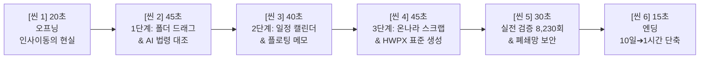

# [2026 공공 AI 대전환 챌린지] 시연영상 상세 연출 콘티 및 대본_261023

- **출품 과제**: 세션 2 지정과제 ① [업무바통(인수인계)]
- **작품명**: 세션2 업무바통 바로업무 - 온나라 연계 AI 인수인계 솔루션 (v2.1.5)
- **최적 권장 러닝타임**: **3분 15초** (지루한 군더더기를 완전히 덜어낸 고밀도 핵심 실무 시연)
- **영상 규격**: 1920×1080 (FHD), 60fps 권장

---

## ⏱️ 씬(Scene) 전체 요약 (총 3분 15초)



---

## 🎬 씬별 상세 연출 및 촬영 대본

---

### 씬 1. [오프닝] 인사이동의 막막함, 1초 만에 풀다 (00:00 ~ 00:20 / 20초)

```text
┌─────────────────────────────────────────────────────────────┐
│ [화면 구성]                                                 │
│ • (좌측) 어지럽게 널려있는 수십 개의 윈도우 탐색기 폴더와 HWP   │
│ • (중앙 전환) 『바로업무.exe』 더블클릭 ➔ 1초 만에 깔끔한 UI 오픈 │
│ • 세련된 타이틀: 『업무바통 바로업무』                      │
└─────────────────────────────────────────────────────────────┘
```

* **화면 연출 (Camera & Action)**:
  1. (00:00~00:07) 윈도우 바탕화면에 어지럽게 널려 있는 `새 폴더(3)`, `2024_인수인계_진짜최종.hwp` 등 답답한 탐색기 화면을 빠른 템포로 보여줍니다.
  2. (00:07~00:20) 화면 중앙에서 `바로업무.exe`를 더블클릭하자, 단 1초 만에 깔끔하고 선명한 메인 캘린더와 인수인계 대시보드가 시원하게 펼쳐집니다.
* **효과음 (SFX)**: 답답한 마우스 클릭음 ➔ 경쾌한 시스템 기동음(`슉- 딩!`)
* **음성 나레이션 (TTS/Voice)**:
  > "인사이동 때마다 전임자가 남긴 수천 개의 파일 속에서 길을 잃고, 배경조차 알 수 없는 기안문 때문에 야근하셨습니까?  
  > 윈도우 폴더 체계를 그대로 살리고 전자결재와 법령까지 단 1초 만에 이어주는 공직 특화 AI 인수인계 솔루션, 『업무바통 바로업무』입니다."
* **화면 하단 자막**:
  ```text
  [인사이동의 현실] 파편화된 문서 폴더, 끊어진 업무 맥락, 누락된 행정 절차
  [솔루션] 온나라 연계 & AI 법령·업무편람 기반 공공 인수인계 솔루션 『업무바통』
  ```

---

### 씬 2. [1단계: 업무] 폴더 드래그 ➔ 계층 트리 복원 & AI 법령 대조 (00:20 ~ 01:05 / 45초)

```text
┌─────────────────────────────────────────────────────────────┐
│ [화면 구성]                                                 │
│ • 상단 [업무] 클릭 ➔ 모의 폴더를 좌측 트리로 드래그&드롭    │
│ • 1초 만에 서무·예산·현안 3개 탭 & 30개 단위업무 자동 생성   │
│ • 『불용품처분계획.hwpx』 열람 ➔ [AI 법령 대조] 클릭        │
│ • AI가 공유재산법 제65조 위반 2건 감지 ➔ 문서 자동 수정      │
└─────────────────────────────────────────────────────────────┘
```

* **화면 연출 (Camera & Action)**:
  1. (00:20~00:32) 상단 **[업무]** 메뉴 클릭. 윈도우 탐색기에서 `04_모의데이터_인수인계샘플` 폴더를 화면 좌측 트리로 쓱 끌어다 놓습니다. 팝업창에서 [모두 덮어쓰기] ➔ [인수인계 시작] 클릭.
  2. (00:32~00:45) **[1초 자동 복원]** 하단에 '서무복무', '예산회계', '현안사업' 3개 탭과 12개 분류, 30개 단위업무가 깔끔한 트리로 정렬됩니다. `1/물품자산/불용품처분계획.hwpx`를 클릭합니다.
  3. (00:45~01:05) 내장 에디터로 본문이 열리고 우측에 증빙 첨부파일 2건과 북마크가 보입니다. 상단 배너의 **[참조 법령: 공유재산법 제65조]**를 클릭하고 **[AI 법령 대조 분석]** 실행!  
     AI가 "심의위원회 의결 누락", "내용연수 미달 사유 미비" 2건을 빨간색으로 짚어내고, [수정안 반영]을 누르자 본문이 올바른 공문 양식으로 즉시 교정됩니다.
* **효과음 (SFX)**: 폴더 드롭 시 `탁!`, AI 분석 완료 시 `반짝- (Chime)`
* **음성 나레이션 (TTS/Voice)**:
  > "첫 번째, '업무 인수인계와 AI 법령 검토'입니다.  
  > 전임자의 폴더를 끌어다 놓기만 하면, 1초 만에 대분류, 중분류, 단위업무의 계층 구조로 즉시 복원됩니다.  
  > 불용품 처분 문서를 열어보겠습니다. 공문 본문과 증빙 첨부파일이 완벽히 보존되어 있습니다.  
  > 여기서 상단의 'AI 법령 대조'를 누르면, 국가법령정보센터의 최신 조문과 대조하여 누락된 심의 절차를 스스로 찾아내고 정식 공문서 양식으로 즉시 교정해 줍니다."
* **화면 하단 자막**:
  ```text
  [원클릭 바통터치] 전임자 폴더 드래그 ➔ 30개 단위업무 계층 트리 1초 자동 복원
  [AI 법령 대조] 국가법령정보 DRF API 실시간 연동 ➔ 누락 절차·위반 조항 사전 경고 및 자동 교정
  ```

---

### 씬 3. [2단계: 일정·메모] 중요 일정 캘린더 직행 & 플로팅 메모 분리 (01:05 ~ 01:45 / 40초)

```text
┌─────────────────────────────────────────────────────────────┐
│ [화면 구성]                                                 │
│ • 좌측 상단 [일정등록] 클릭 ➔ 메인 [캘린더] 탭으로 이동     │
│ • 11월 13일 칸에 『물품심사위원회』 등록 (공휴일/음력 표기)  │
│ • 우측 상단 [플로팅 메모] 클릭 ➔ 바탕화면 노란 위젯 분리     │
│ • [캡처] 버튼으로 화면 속 비상연락망 원클릭 박제            │
└─────────────────────────────────────────────────────────────┘
```

* **화면 연출 (Camera & Action)**:
  1. (01:05~01:20) 업무 상세창 좌측 상단의 **[일정등록]** 버튼 클릭 ➔ 확인. 상단 메인 메뉴의 **[캘린더]** 탭으로 전환하자, 11월 13일 칸에 『물품심사위원회 개최』가 자동으로 쏙 들어가 있습니다. 날짜 칸 아래의 음력과 공휴일 표기가 클로즈업됩니다.
  2. (01:20~01:45) 우측 상단의 **[플로팅 메모]** 버튼을 클릭하자, 포스트잇 모양의 메모가 바탕화면으로 톡 분리되어 항상 최상위에 머뭅니다. 메모창 상단의 **[캡처]** 아이콘을 눌러 실무 비상연락망을 사각형으로 드래그하자, 메모 안에 즉시 영구 박제됩니다.
* **효과음 (SFX)**: 캘린더 등록 `딸깍`, 화면 캡처 `찰칵!`
* **음성 나레이션 (TTS/Voice)**:
  > "두 번째는 '일정과 메모의 입체 연계'입니다.  
  > 업무에 포함된 중요 행사는 클릭 한 번으로 메인 캘린더에 연동되며, 법정공휴일과 음력까지 자동 계산됩니다.  
  > 수시로 확인해야 하는 실무 지침과 비상연락망은 '바탕화면 플로팅 메모'로 분리할 수 있습니다. 화면 캡처 기능을 통해 다른 프로그램을 쓰면서도 중요 참고 자료를 항상 곁에 두고 볼 수 있습니다."
* **화면 하단 자막**:
  ```text
  [일정 자동 연계] 단위업무의 중요 행사·마감일 ➔ 월간 캘린더로 원클릭 즉시 전송
  [바탕화면 플로팅 메모] 독립 위젯 분리 & 화면 캡처 원클릭 박제 지원
  ```

---

### 씬 4. [3단계: 온나라 스크랩] 전자결재 1초 스크랩 & HWPX 표준 생성 (01:45 ~ 02:30 / 45초)

```text
┌─────────────────────────────────────────────────────────────┐
│ [화면 구성]                                                 │
│ • 브라우저 온나라 결재 화면 ➔ 우클릭 [바로업무로 보내기]    │
│ • 바로업무 업무 카드로 기안문 요약·결재선 실시간 누적        │
│ • [업무 부가기능] ➔ [메모로 문서 생성] 원클릭               │
│ • 행안부 편람 표준 양식의 인수인계서 HWPX 초안 완성!        │
└─────────────────────────────────────────────────────────────┘
```

* **화면 연출 (Camera & Action)**:
  1. (01:45~02:05) 크롬 브라우저에서 `온나라_모의전자결재사이트`를 엽니다. 결재 진행 중인 기안문 위에서 마우스 우클릭 ➔ **[바로업무로 보내기]** (단축키 `Ctrl + Shift + K`) 클릭!
  2. (02:05~02:18) 바로업무 창으로 화면이 매끄럽게 포커싱되며, 열려 있던 '불용품처분계획' 카드 안으로 온나라 기안문 제목, 본문 핵심 요약, 결재선 정보가 1초 만에 실시간 적재되는 모습이 보입니다.
  3. (02:18~02:30) 상단 **[업무 부가기능] ➔ [메모로 문서 생성]**을 누르자, 행정안전부 《행정업무운영 편람》 표준 서식(표와 개조식 어법)을 완벽히 갖춘 정식 HWPX 인수인계서 초안이 눈앞에 완성됩니다.
* **효과음 (SFX)**: 우클릭 전송 `휙- (Whoosh)`, 문서 완성 `짜잔- (Success)`
* **음성 나레이션 (TTS/Voice)**:
  > "세 번째, 공무원의 주 무대인 '온나라 전자결재 연동'입니다.  
  > 웹 결재함에서 마우스 우클릭 한 번으로 기안문의 제목, 요약 본문, 결재선이 내가 진행 중인 단위업무 카드로 즉시 스크랩됩니다.  
  > 이렇게 모인 실무 맥락은 '메모로 문서 생성'을 통해, 행정안전부 규격을 완벽히 준수한 정식 인수인계서 HWPX 문서로 1초 만에 재탄생합니다."
* **화면 하단 자막**:
  ```text
  [온나라 1초 스크랩] 크롬 확장프로그램 우클릭(Ctrl+Shift+K) ➔ 기안문·결재선 자동 적재
  [표준 인수인계서 생성] 행안부 편람 개조식 표준 서식(HWPX) 1초 만에 자동 생성
  ```

---

### 씬 5. [실전 검증] 온나라 지식 8,230회 돌파 & 안전한 폐쇄망 AI (02:30 ~ 03:00 / 30초)

```text
┌─────────────────────────────────────────────────────────────┐
│ [화면 구성]                                                 │
│ • (좌측) 온나라 지식 배포 8,230회 & 우수지식 마크 줌인       │
│ • (중앙) 전국 공직자 호평 댓글 및 타 부처 감사 메일         │
│ • (우측) 공공 GitLab 5대 보안 스캔 전 항목 [PASS] 인증 마크 │
└─────────────────────────────────────────────────────────────┘
```

* **화면 연출 (Camera & Action)**:
  1. (02:30~02:45) 온나라 지식 포털 캡처 화면 줌인: **'누적 조회수 8,230회 돌파'**와 **'기관 우수지식 공식 선정'** 배지가 강조됩니다. 이어지는 전국 실무자들의 "인수인계 악몽을 끝내준 도구" 댓글이 스크롤됩니다.
  2. (02:45~03:00) 공공 GitLab 사전 보안 검사 요약표 클로즈업: Semgrep, Gitleaks, Trivy 등 5대 보안 스캔이 **전부 초록색 [PASS]**로 통과된 화면과 로컬 100% 암호화 아키텍처 다이어그램이 표출됩니다.
* **효과음 (SFX)**: 스탬프 쾅 찍히는 소리 (`쾅! PASS`)
* **음성 나레이션 (TTS/Voice)**:
  > "『업무바통 바로업무』는 단순한 공모전 시제품이 아닙니다.  
  > 정부 지식행정포털(온나라 지식)에서 누적 조회수 8,230회를 돌파하고 기관 우수지식으로 검증받은 현장 솔루션입니다.  
  > 외부 유출 없는 100% 로컬 암호화와 오프라인 룰 엔진으로 행정 폐쇄망에서도 안전하며, 공공 GitLab의 엄격한 보안 검증을 모두 무결점으로 통과했습니다."
* **화면 하단 자막**:
  ```text
  [현장 실증] 온나라 지식 누적 8,230회 돌파 & 기관 우수지식 공식 선정
  [행정망 보안] 100% 로컬 암호화 & 공공 GitLab 5대 보안 검증 전 항목 무결점 PASS
  ```

---

### 씬 6. [엔딩] 10일에서 1시간으로, 지능형 정부의 미래 (03:00 ~ 03:15 / 15초)

```text
┌─────────────────────────────────────────────────────────────┐
│ [화면 구성]                                                 │
│ • 인포그래픽: 기존 10일 이상 ➔ 당일 1시간 (90% 단축)        │
│ • 엔딩 카드: 『세션2 업무바통 바로업무』 공식 로고 & 버전    │
│ • 하단 문구: 2026 공공 AI 대전환 챌린지 세션 2 지정과제 ①    │
└─────────────────────────────────────────────────────────────┘
```

* **화면 연출 (Camera & Action)**:
  1. (03:00~03:08) 깔끔한 모션 그래픽: 기존 인수인계 기간 막대그래프(10일)가 1시간으로 쑥 줄어들며 `90% 시간 단축` 강조.
  2. (03:08~03:15) 세련된 블루/네이비 톤의 공식 엔딩 타이틀 카드 표출.
* **음성 나레이션 (TTS/Voice)**:
  > "인수인계 파악 기간을 10일에서 단 1시간으로 단축시키는 혁신.  
  > 전임자와 후임자를 신뢰로 이어주는 『업무바통 바로업무』가 2027년 지능형 정부의 새로운 표준을 열어가겠습니다. 감사합니다."
* **화면 하단 자막**:
  ```text
  [정량적 효과] 인수인계 업무 파악 기간 90% 대폭 단축 (10일 ➔ 당일 1시간)
  세션2 업무바통 바로업무 - AI 기반 공공 행정 인수인계 솔루션 (v2.1.5)
  ```
