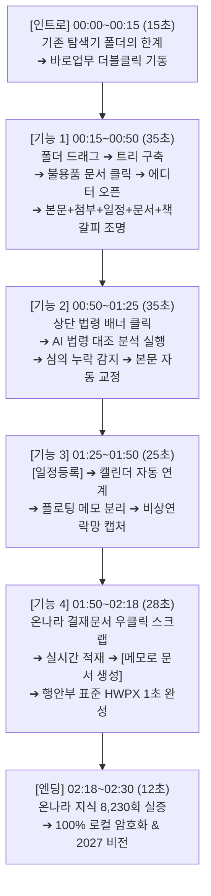

# [2026 공공 AI 대전환 챌린지] 100% 제품 기능 시연 마스터 스크립트_261023
## (마우스 동선 × 에디터·UI 반응 × 1:1 실시간 나레이션 싱크)

- **출품 과제**: 세션 2 지정과제 ① [업무바통(인수인계)]
- **작품명**: 세션2 업무바통 바로업무 - 온나라 연계 AI 인수인계 솔루션 (v2.1.5)
- **영상 규격**: 1920×1080 (FHD), 60fps, 16:9 와이드스크린
- **총 재생시간**: **정확히 2분 30초 (150초)** - 늘어짐 없는 고밀도 제품 시연 골든타임
- **특징**: 배우/인물 배제, **오직 소프트웨어 화면(UI)과 마우스 실시간 인터랙션만으로 기능의 가치를 증명하는 100% 프로덕트 테크 데모**

---

## ⏱️ 타임라인 및 마우스 액션 전체 흐름도



---

## 🎬 씬별 마우스 동선 & 실시간 나레이션 마스터 대본

---

### [씬 1] 인트로: 수십 년간 익숙했던 윈도우 폴더의 한계 (00:00 ~ 00:15 / 15초)

* **화면 동작 (Mouse & UI Action)**:
  - (00:00~00:08) 윈도우 바탕화면과 탐색기 창. `새 폴더(2)`, `2024_물품관리_최종_수정.hwp` 등 수백 개의 파일이 정렬 없이 흩어져 있고 마우스 휠이 파일을 찾으려 위아래로 방황함.
  - (00:08~00:15) 바탕화면 중앙의 `바로업무.exe` 아이콘을 마우스가 빠르게 더블클릭. **단 1초 만에** 화면 전체가 밝아지며 깔끔한 네이비/청록색 톤의 바로업무 메인 대시보드 기동.
* **🎙️ 나레이션 대본 (Voiceover)**:
  > "공무원들은 수십 년간 윈도우 폴더로 일해왔습니다. [0.3초 쉼]  
  > 하지만 폴더 속 파일들은 단절되어 있고, 문서와 일정, 결재문서와 법령은 제각각 흩어져 있습니다. [0.4초 쉼]  
  > 이제 이 익숙한 윈도우 폴더 체계를 단 1초 만에 살아있는 업무 편람으로 바꾸는 솔루션, [0.2초 쉼]  
  > 【업무바통 바로업무】를 시작합니다."
* **화면 자막**:
  ```text
  [기존 윈도우 폴더의 한계] 흩어진 파일, 끊어진 업무 맥락, 누락된 행정 절차
  [솔루션] 온나라 연계 AI 인수인계 솔루션 『업무바통 바로업무』
  ```
* **효과음 (SFX)**: 마우스 헛클릭 ➔ 더블클릭음(`딸깍`) ➔ 상쾌한 기동음(`슉- 딩!`)

---

### [씬 2] 기능 1: 비파괴적 폴더 수용 & 4-in-1 일체형 편람 (00:15 ~ 00:50 / 35초)
> **사용자님 디렉팅 100% 반영 파트**: 드래그 즉시 구축 ➔ `불용품처분계획` 클릭 ➔ 에디터 열림 ➔ 본문 + 첨부파일 + 관련일정 + 전자문서 + 책갈피 연계 조명

* **화면 동작 (Mouse & UI Action)**:
  1. (00:15~00:23) 상단 메뉴 바에서 **[업무]** 버튼 클릭. 윈도우 탐색기에서 노란색 폴더 `04_모의데이터_인수인계샘플`을 마우스로 잡고 좌측 업무 트리 영역으로 부드럽게 드래그 & 드롭! 모달 창에서 [모두 덮어쓰기] 체크 후 **[인수인계 시작]** 버튼 클릭.
  2. (00:23~00:29) **[1초 자동 구조화]** 화면 하단에 `서무복무(1)`, `예산회계(2)`, `현안사업(3)` 탭이 생기며, 12개 분류와 30개 단위업무가 계층 트리로 촤라락 완성됨.
  3. (00:29~00:36) 마우스 커서가 트리 목록에서 `1 / 물품자산 / 불용품처분계획.hwpx` 행으로 이동하여 **딸깍 클릭!** ➔ 화면 중앙에 **내장 HWPX 에디터가 시원하게 열리며** 표와 공문 서식이 완벽하게 렌더링됨.
  4. (00:36~00:50) 카메라가 에디터 본문을 비춘 뒤 우측 패널로 자연스럽게 이동:
     - 우측 상단: `첨부파일 (2)`에 `불용품현황조사서.xlsx`, `감정평가결과표.pdf` 파일 아이콘 하이라이트.
     - 우측 중단: **[관련 일정]** `2026. 11. 13. 물품심사위원회 개최` 일정 링크 하이라이트.
     - 우측 하단: **[관련 전자문서]** 연계 기안문 링크 및 **[책갈피]** 2건이 한 화면에 입체적으로 포커싱됨.
* **🎙️ 나레이션 대본 (Voiceover)**:
  > "기존의 폴더 체계를 억지로 바꿀 필요가 없습니다. [0.3초 쉼]  
  > 쓰던 인수인계 폴더를 마우스로 끌어다 놓기만 하십시오. [0.4초 쉼]  
  > 단 1초 만에, 대분류, 중분류, 단위업무의 입체 계층 트리가 즉시 구축됩니다. [0.5초 쉼]  
  > 그중에서 '불용품 처분 계획' 문서를 클릭해보겠습니다. [0.3초 쉼]  
  > 클릭 즉시 내장 에디터가 시원하게 열리며, [0.3초 쉼]  
  > 정식 공문 본문뿐만 아니라, [0.2초 쉼] 우측의 증빙 첨부파일 두 건, [0.2초 쉼] 연계된 중요 심사 일정, [0.2초 쉼] 관련 전자문서와 책갈피까지! [0.3초 쉼]  
  > 업무에 필요한 모든 맥락이 하나의 카드에 완벽하게 살아납니다."
* **화면 자막**:
  ```text
  [원클릭 바통터치] 전임자 폴더 드래그 ➔ 30개 단위업무 계층 트리 1초 자동 복원
  [4-in-1 일체형 편람] 공문 본문(HWPX) + 증빙 첨부파일 + 관련 일정 + 전자문서 + 책갈피
  ```
* **효과음 (SFX)**: 폴더 드롭음(`탁!`), 목록 정렬음(`촤라락-`), 파일 클릭음(`딸깍`), 에디터 오픈음(`착-`), 4대 요소 하이라이트 비프음(`띵- 띵- 띵-`)

---

### [씬 3] 기능 2: AI 법령 실시간 대조 & 감사 리스크 차단 (00:50 ~ 01:25 / 35초)

* **화면 동작 (Mouse & UI Action)**:
  1. (00:50~00:58) 에디터 본문 상단에 파랗게 떠 있는 배너: `[참조 법령] 공유재산 및 물품 관리법 제65조 (불용품의 매각 등)`를 마우스가 클릭.
  2. (00:58~01:12) 비교 모달 창 오픈: 좌측 '내 업무 문서' vs 우측 '국가법령정보센터 DRF API 최신 조문'.  
     마우스가 **[AI 법령 대조 분석 시작]** 클릭 ➔ AI 스캔 빔이 지나가며 빨간색 경고 라벨 2건 표출:  
     - `제1항 단서에 따른 물품관리심의회 심의 절차 누락`  
     - `내용연수 미달 품목 처분 사유 명시 필요`
  3. (01:12~01:25) 하단의 녹색 버튼 **[선택한 2개 항목만 문서에 반영]**을 마우스가 클릭 ➔ 모달이 닫히며 에디터 본문의 누락 조항 칸에 법령 표준 행정 문구가 초록색으로 자동 채워지며 완벽히 교정됨.
* **🎙️ 나레이션 대본 (Voiceover)**:
  > "단순히 문서만 넘겨받는다고 업무를 할 수 있을까요? [0.3초 쉼] 진짜 문제는 '감사 지적 리스크'입니다. [0.4초 쉼]  
  > 상단의 참조 법령 배너를 누르면, AI가 국가법령정보센터의 최신 조문과 내 문서를 실시간 대조합니다. [0.4초 쉼]  
  > 필수 절차인 '물품심의위원회 의결 누락'을 사전에 감지하고, [0.3초 쉼]  
  > 버튼 한 번으로 법령에 부합하는 표준 행정 문구를 본문에 즉시 채워 넣어 결재 반려와 감사 지적을 원천 차단합니다."
* **화면 자막**:
  ```text
  [AI 법령 대조] 국가법령정보(DRF API) 실시간 연동 ➔ 누락 절차 2건 사전 감지
  [본문 자동 교정] 표준 행정 문구 본문 즉시 반영 ➔ 감사 지적 리스크 원천 차단
  ```
* **효과음 (SFX)**: 배너 클릭음(`띵`), AI 스캐닝음(`샤-앙`), 오류 감지음(`두둥!`), 교정 완료 차임벨(`반짝- Chime`)

---

### [씬 4] 기능 3: 업무와 일정의 입체 연계 — 캘린더 & 플로팅 메모 (01:25 ~ 01:50 / 25초)

* **화면 동작 (Mouse & UI Action)**:
  1. (01:25~01:33) 업무창 좌측 상단의 **[일정등록]** 버튼 클릭 ➔ 팝업 확인 후 상단 메인 메뉴 **[캘린더]** 탭 클릭. 11월 13일 금요일 칸에 보라색 스티커로 『물품심사위원회 개최 (14:00)』 일정이 안착됨.
  2. (01:33~01:40) 날짜 셀 클로즈업: 빨간색 공휴일, 대체공휴일 라벨, 음력(`10.5`), 24절기(`입동`) 표기 줌인.
  3. (01:40~01:50) 우측 상단 **[플로팅 메모]** 아이콘 클릭 ➔ 노란 포스트잇 위젯이 바탕화면으로 톡 분리 ➔ 메모 상단 **[캡처]** 아이콘 클릭 ➔ 사내 비상연락망을 사각형 드래그하여 메모 안으로 고화질 박제!
* **🎙️ 나레이션 대본 (Voiceover)**:
  > "업무는 일정과 분리될 수 없습니다. [0.3초 쉼]  
  > '일정등록'을 누르면 11월 13일 심사 일정이 메인 캘린더로 즉시 전송되며, 대한민국 전체 공휴일과 음력까지 자체 계산됩니다. [0.4초 쉼]  
  > 또한 수시로 확인해야 하는 실무 지침은 플로팅 메모로 분리하고, [0.2초 쉼] 화면 캡처 한 번으로 비상연락망을 메모 안에 고화질로 즉시 박제할 수 있습니다."
* **화면 자막**:
  ```text
  [일정 자동 연계] 단위업무 중요 행사 ➔ 월간 캘린더 원클릭 전송 (공휴일·음력 지원)
  [바탕화면 플로팅 메모] 독립 위젯 분리 & 비상연락망 화면 캡처 원클릭 박제
  ```
* **효과음 (SFX)**: 캘린더 안착음(`톡`), 위젯 분리음(`퐁- Pop`), 캡처 셔터음(`찰칵!`)

---

### [씬 5] 기능 4: 온나라 1초 스크랩 & 표준 HWPX 인수인계서 생성 (01:50 ~ 02:18 / 28초)

* **화면 동작 (Mouse & UI Action)**:
  1. (01:50~01:58) 크롬 브라우저 속 온나라 모의 결재함 화면. 마우스가 기안문 위에서 우클릭 ➔ **[바로업무로 보내기 (Ctrl+Shift+K)]** 클릭!
  2. (01:58~02:07) 바로업무 프로그램으로 화면 전환. 열려 있던 불용품 업무 카드 안으로 온나라 기안문 제목, 본문 요약, 결재선 정보가 카드 형태로 1초 만에 쏙 적재됨.
  3. (02:07~02:18) 업무창 상단 **[업무 부가기능] ➔ [메모로 문서 생성]** 클릭! 게이지가 차오르고, 행정안전부 《행정업무운영 편람》 기준의 표와 개조식 부호(□, ○, -)를 갖춘 정식 HWPX 인수인계서 초안이 화면 가득 완성됨!
* **🎙️ 나레이션 대본 (Voiceover)**:
  > "공무원의 주 무대인 온나라 전자결재 연동도 완벽합니다. [0.3초 쉼]  
  > 웹 결재함에서 마우스 우클릭 한 번으로 기안문의 제목, 요약 본문, 결재선이 단위업무 카드로 즉시 스크랩됩니다. [0.4초 쉼]  
  > 이렇게 수집된 실무 맥락은 '메모로 문서 생성' 기능을 통해, [0.2초 쉼]  
  > 행정안전부 《행정업무운영 편람》 표준 서식과 개조식 어법을 갖춘 [0.2초 쉼]  
  > 정식 인수인계서 HWPX 문서로 1초 만에 완성됩니다."
* **화면 자막**:
  ```text
  [온나라 1초 스크랩] 크롬 확장 우클릭(Ctrl+Shift+K) ➔ 기안문·결재선 자동 적재
  [표준 인수인계서 생성] 행안부 편람 개조식 표준 서식(HWPX) 1초 자동 완성
  ```
* **효과음 (SFX)**: 우클릭음(`딸깍`), 데이터 안착음(`휙- 쏙!`), 팡파르(`짜잔- Orchestral Hit`)

---

### [씬 6] 엔딩: 검증된 기술력과 안전한 공직 보안 (02:18 ~ 02:30 / 12초)

* **화면 동작 (Mouse & UI Action)**:
  - 온나라 지식 포털 누적 8,230회 카운터 & 우수지식 마크 ➔ 전국 공직자 호평 댓글 ➔ 공공 GitLab 5대 보안 검증 **[SECURITY SCAN PASSED]** 도장 ➔ 인수인계 10일 ➔ 1시간 단축 엠블럼 표출 ➔ 페이드아웃.
* **🎙️ 나레이션 대본 (Voiceover)**:
  > "온나라 지식 누적 8,230회 돌파와 우수지식 선정으로 검증된 현장 솔루션! [0.3초 쉼]  
  > 100% 로컬 암호화로 행정 폐쇄망에서도 안전하게 작동합니다. [0.3초 쉼]  
  > 인수인계 10일을 단 1시간으로 단축시키는 혁신, [0.2초 쉼]  
  > 2027년 지능형 정부의 새로운 표준을 만듭니다."
* **화면 자막**:
  ```text
  [현장 실증] 온나라 지식 8,230회 돌파 & 공공 GitLab 5대 보안 검증 PASS
  세션2 업무바통 바로업무 (v2.1.5) | 2027 지능형 정부 표준 인수인계 솔루션
  ```
* **효과음 (SFX)**: 도장음(`쾅! PASS`), 수치 압축음(`슝- 쿵!`), 감동적인 오케스트라 피날레(`둥-`)
